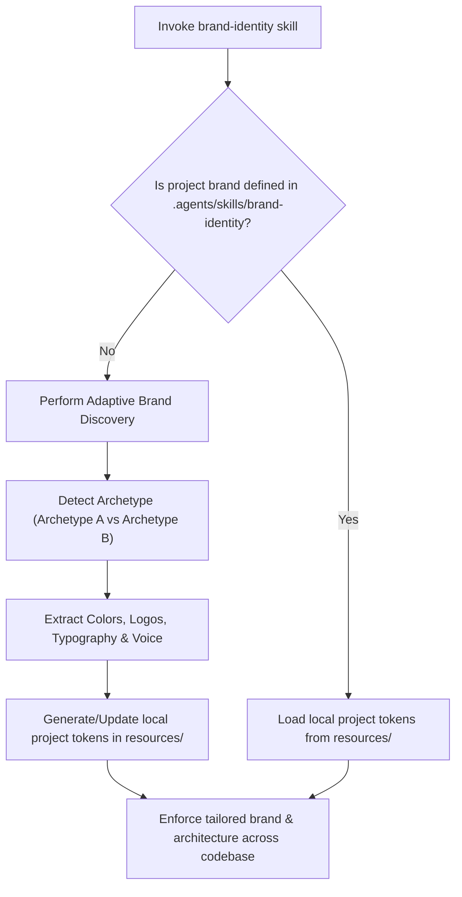

# Adaptive Brand Analyzer & Customization Protocol

## Overview

This protocol enables the `brand-identity` skill to analyze, extract, adapt, and enforce the unique corporate, educational, or project brand identity and technical architecture for **ANY current or future project** in Antigravity.

It supports dual native archetypes:
1. **Archetype A (Core Web / Transaccional - CEIA / SWGA Baseline)**: PHP 8.2+ POO/MVC, PostgreSQL 14+, PDO, pure HTML5/CSS3.
2. **Archetype B (Cloud-Native & AI-First - Wellness Platform 2.0 Baseline)**: Python 3.11+, FastAPI, Pydantic v2, pgvector, Intelligent Agents, Docker & Multi-Cloud deployment (GCP, AWS).

---

## 🔍 Step-by-Step Adaptive Brand Onboarding Workflow

---

## 📋 Phase 1: Brand & Architecture Discovery Checklist

When starting or adapting a new project, evaluate the following five dimensions:

### 1. Architectural Archetype Selection
- **Archetype A (Enterprise Transaccional)**: Monolithic / Modular MVC in PHP 8.2+, Apache/XAMPP, PostgreSQL/MariaDB, HTML5/CSS3.
- **Archetype B (Cloud-Native AI-First)**: Microservices in Python 3.11+ / FastAPI, Agentic frameworks, pgvector + Redis, Docker containerized, deployable to GCP Cloud Run / AWS ECS.

### 2. Identity & Palette Matrix
- **Organization Name**: Official name, acronym, and sub-brands.
- **Primary Surface Theme**: Dark mode default (futuristic/cyber quantum), Light mode default (clean/academic), or Dual Adaptive theme.
- **Color Tokens**:
  - Primary Brand Color (HEX / HSL)
  - Secondary Accent Color (Cyan / Indigo / Neon accents)
  - Background & Surface Glass colors (`rgba(...)` + `backdrop-filter`)
  - High-Contrast Text Tokens

### 3. Typography & Visual Assets
- **Corporate Font Family**: Google Fonts selection (Inter, Outfit, Montserrat, Roboto, Fira Code for technical contexts).
- **Iconography Style**: Feather Icons, Lucide, Tabler, or Custom SVG system.
- **Logo Usage Rules**: SVG vector format, minimum size constraints, dark/light variations.

### 4. Technical Stack & Cloud Deployment Constraints
- **Backend Architecture**: Python FastAPI asíncrono, PHP 8+ POO/MVC, or Node.js.
- **Database Engine**: PostgreSQL 14+ (with optional `pgvector`), MariaDB/MySQL, or Redis.
- **Container & Cloud Readiness**: Multi-stage Dockerfile, non-root user, dynamic `$PORT`, healthcheck `/health`, GitHub Actions CI/CD to GCP / AWS.
- **Security & Data Sanitization**: Mandatory prepared statements, input validation with Pydantic / PDO, environment variables `.env`.

### 5. Communication & Voice Matrix
- **Target Audience**: Students, professors, academic researchers, enterprise clients, or AI users.
- **Language & Region**: Spanish (es-ES / es-VE / es-MX), English, or Multilingual.
- **Tone**: Formal Academic, Pair Programming Coach, Modern Tech Innovator, or Technical Datasheet (Google AI Coding style).

---

## 🛠️ Phase 2: Generating Local Project Tokens

When adapting to a new project (e.g., *Educational Institution X*, *Wellness Platform 2.0*, or *Enterprise SaaS Y*):

1. Create/Update local directory: `.agents/skills/brand-identity/resources/`
2. Populate custom files:
   - `design.md`: Custom CSS variables, glassmorphic cards, and UI component guidelines.
   - `tech-stack.md`: Project-specific architectural constraints, archetype definition, and cloud rules.
   - `voice-tone.md`: Project-specific communication tone and documentation headers.
3. Commit and push the project-level `.agents/skills/brand-identity/` to the repository so the team and Antigravity agents share the exact same standards.
