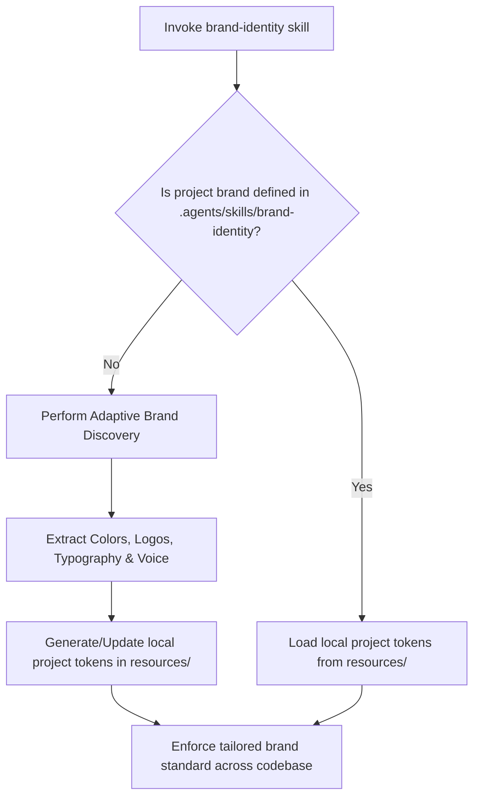

# Adaptive Brand Analyzer & Customization Protocol

## Overview

This protocol enables the `brand-identity` skill to analyze, extract, adapt, and enforce the unique corporate, educational, or project brand identity for **ANY current or future project** in Antigravity.

While **CEIA / SWGA** serves as the default reference implementation, every new educational institution, startup, or enterprise platform has distinct aesthetic, architectural, and communicative requirements.

---

## 🔍 Step-by-Step Adaptive Brand Onboarding Workflow

---

## 📋 Phase 1: Brand Discovery & Analysis Checklist

When starting or adapting a new project, evaluate the following four dimensions:

### 1. Identity & Palette Matrix
- **Organization Name**: Official name, acronym, and sub-brands.
- **Primary Surface Theme**: Dark mode default (futuristic/cyber), Light mode default (clean/academic), or Dual Adaptive theme.
- **Color Tokens**:
  - Primary Brand Color (HEX / HSL)
  - Secondary Accent Color
  - Background & Surface Glass colors
  - High-Contrast Text Tokens

### 2. Typography & Visual Assets
- **Corporate Font Family**: Google Fonts selection (Inter, Outfit, Montserrat, Roboto, Fira Code for technical contexts).
- **Iconography Style**: Feather Icons, Lucide, Tabler, or Custom SVG system.
- **Logo Usage Rules**: SVG vector format, minimum size constraints, dark/light variations.

### 3. Technical Stack Constraints
- **Backend Architecture**: PHP 8+ POO/MVC, Node.js, Python, or framework-specific rules.
- **Database Engine**: PostgreSQL 14+, MariaDB/MySQL, or SQLite.
- **Security & Data Sanitization**: Mandatory PDO prepared statements, input escaping, environment variables `.env`.

### 4. Communication & Voice Matrix
- **Target Audience**: Students, professors, academic researchers, enterprise clients.
- **Language & Region**: Spanish (es-ES / es-VE / es-MX), English, or Multilingual.
- **Tone**: Formal Academic, Pair Programming Coach, Modern Tech Innovator, or Technical Datasheet (Google AI Coding style).

---

## 🛠️ Phase 2: Generating Local Project Tokens

When adapting to a new project (e.g., *Educational Institution X* or *Platform Y*):

1. Create/Update local directory: `.agents/skills/brand-identity/resources/`
2. Populate custom files:
   - `design.md`: Custom CSS variables and UI component guidelines.
   - `tech-stack.md`: Project-specific architectural constraints and security rules.
   - `voice-tone.md`: Project-specific communication tone and documentation headers.
3. Commit and push the project-level `.agents/skills/brand-identity/` to the repository so the team shares the exact same brand rules.
