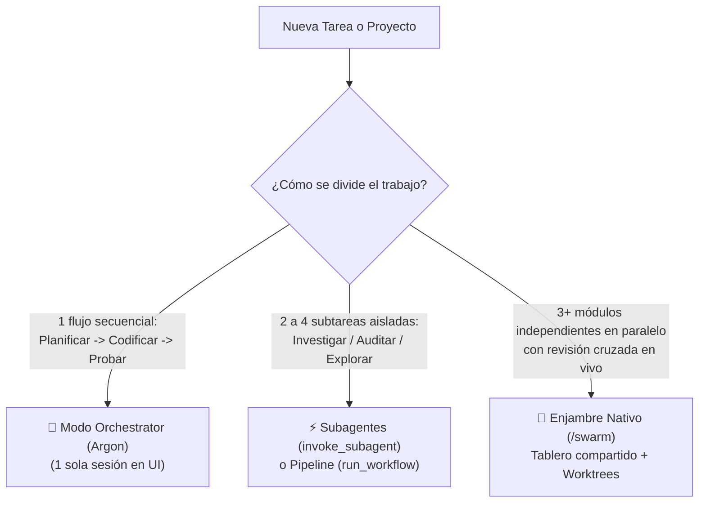

# Gemini 4 Orchestrator & Swarm Pro (Google Antigravity)

Habilidad estratégica para maximizar el rendimiento de la familia **Gemini 4** (`Argon`, `Hydrogen`, `Orchestrator (Argon)`) y ejecutar equipos de agentes en paralelo mediante **`/swarm`** y **`run_workflow`**, optimizando el presupuesto de cuotas del plan **Gemini AI Pro**.

---

## 1. Diagnóstico Real de Modelos en tu Plan Gemini Pro

Aunque **Gemini 4 Carbon** está reservado para planes Ultra/Enterprise, tu suscripción **Gemini Pro** incluye acceso completo (verificado vía `swarm{action:"models"}`) a toda la arquitectura de razonamiento y ejecución de Gemini 4:

| Modelo en Antigravity | ID Interno | Ciclo de Cuota | Rol Ideal en Ingeniería |
| :--- | :--- | :--- | :--- |
| **Orchestrator (Argon)** | `gemini-pro-orchestrator-g1-pro` | **Semanal** (7 días) | **Coordinador Dual Automático:** Planifica con Argon y delega la codificación/tests en Hydrogen dentro de la misma sesión. |
| **Gemini 4 Argon** (`Low` / `Medium` / `High`) | `gemini-4-argon-*` | **Semanal** (7 días) | **Arquitecto Profundo (Elephant):** Diseño de sistemas, decisiones críticas, refactorizaciones multi-módulo y resolución de bloqueos. |
| **Gemini 4 Hydrogen** (`Low` / `Medium` / `High` / `XHigh`) | `gemini-4-hydrogen-*` | **Diario** (24 horas) | **Ejecutor de Alta Velocidad:** Desarrollo diario, workers de `/swarm`, tests, UI y auditorías paralelas sin gastar cuota semanal. |
| **Claude Opus 5.5 / Sonnet 5.5** | `claude-*-5-5-*` | **Diario** (24 horas) | **Verificador / Contraparte:** Excelente para contraste de código, revisión profunda o workers alternativos cuando se requiere diversidad. |
| **Gemini 3.8 Flash** | `gemini-3.8-flash-*` | **Diario** (24 horas) | **Tareas Ligeras:** Consultas rápidas, búsquedas, formateo y subagentes masivos (`flash`). |
| *Gemini 4 Carbon* | *No disponible en Pro* | *Ultra / Enterprise* | Sustituido en Gemini Pro por **Orchestrator (Argon)** + **Hydrogen (XHigh)**. |

---

## 2. Cuándo Usar Cada Mecanismo de Orquestación



### Nivel 1: `Orchestrator (Argon)` (Sin configurar nada extra)
- Selecciónalo directamente en el selector de modelos de Antigravity.
- **Cómo actúa:** **Argon** analiza la arquitectura y traza el plan; automáticamente cede el control a **Hydrogen** para escribir código y correr pruebas. Si un test falla o surge una contradicción arquitectónica, el control regresa a Argon.

### Nivel 2: `run_workflow` (Orquestación Programática en Python)
- Úsalo cuando necesites hacer *fan-out* sobre una lista de archivos, módulos o bugs (`parallel(items, fn)` y `pipeline(items, fn)`).
- Permite fijar `model="flash"` o `"inherit"` por agente y validar salidas con JSON Schema estricto.

### Nivel 3: `/swarm` (Enjambre Cooperativo con Tablero Compartido)
- Actívalo cuando el trabajo se divida en **piezas independientes que pueden ejecutarse al mismo tiempo** y requieran **verificadores cruzados**.

---

## 3. Protocolo para Ejecutar `/swarm` sin Agotar tu Cuota de Gemini Pro

> [!IMPORTANT]
> **Regla de Oro de Cuota en `/swarm`:**
> Por defecto, `swarm{action:"add"}` lanza cada worker en el mismo modelo del coordinador. Si lanzas 8 workers estando en `Gemini 4 Argon`, consumirás tu **cuota semanal** 8 veces más rápido.
> - **Para swarms grandes o de ejecución intensiva:** Inicia la sesión en **Gemini 4 Hydrogen (High o XHigh)** (cuya cuota se renueva **todos los días**) o solicita explícitamente asignar `gemini-4-hydrogen-high` / `gemini-4-hydrogen-xhigh` a los workers ejecutores, reservando `Argon` para decisiones de arquitectura.

### Paso 1: Dimensionar y Nombrar el Enjambre
1. Verifica el estado de cuotas si el trabajo es masivo:
   ```json
   swarm{"action": "models"}
   ```
2. Asigna título al enjambre:
   ```json
   swarm{"action": "title", "title": "Refactorización y Auditoría de Módulos"}
   ```

### Paso 2: Reglas de Oro de Asignación de Workers (`add`)
- **Cero colisiones de archivos:** Un archivo o módulo pertenece a **un solo worker autor** a la vez.
- **Aislamiento de Workspace (`workspace`):**
  - Autores que editan código en paralelo: `workspace: "share"` (crea una copia de trabajo compartiendo el repositorio git) o `"branch"`.
  - Lectores, auditores y verificadores: `workspace: "inherit"`.
- **Proporción de Verificadores:** Añade **1 verificador por cada 2 a 4 autores**. El verificador lee el diff, ejecuta los tests y reporta en el tablero (`@autor corrige X`), pero **nunca edita el archivo del autor**.
- **Brief Autocontenido:** Cada worker nace con contexto cero. Su `brief` debe especificar:
  1. Qué archivos o módulos posee (`You own src/...`).
  2. Qué archivos **no** debe tocar.
  3. Cómo verificar su trabajo y a quién mencionar al terminar (`@verifier` o `@coordinator`).

### Paso 3: Ciclo de Coordinación en el Tablero
1. En el turno donde creas el swarm (`swarm{action:"add"}`), agrega todos los workers necesarios, muestra al usuario el enlace `open_board` devuelto por la herramienta y **termina tu turno** (las herramientas `post_message`, `read_board` y `swarm_wait` se activan en el turno siguiente).
2. En los turnos siguientes:
   - Usa `swarm_wait{since: <ultimo_seq>}` para esperar respuestas sin consumir tokens.
   - Usa `read_board{since: <ultimo_seq>}` para revisar avances.
   - Referencia mensajes previos por número de secuencia (`#4`, `#7`) en lugar de copiar y pegar textos largos.
3. **Recuperación ante Cuota Agotada:**
   - Si un worker agota la cuota de su modelo, **nunca uses `kill`**. Cambia su modelo en caliente conservando toda su memoria con:
     ```json
     swarm{"action": "model", "name": "nombre-worker", "model": "gemini-4-hydrogen-high"}
     ```
4. **Cierre Limpio:**
   - Antes de hacer `kill` a un worker con `workspace: "share"` o `"branch"`, asegúrate de integrar/fusionar sus cambios en el workspace principal, ya que `kill` elimina su copia de trabajo.

---

## 4. Referencias Detalladas de esta Skill

- [references/model-tiers-and-quotas.md](references/model-tiers-and-quotas.md): Tabla comparativa de cuotas diarias vs semanales en Gemini Pro y estrategia de reemplazo de Carbon.
- [references/swarm-playbooks.md](references/swarm-playbooks.md): Plantillas listas para usar de `/swarm` (Desarrollo Full-Stack, Auditoría + Fix, y Migración Multi-Módulo).
