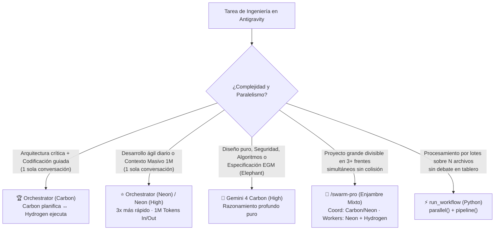

# Gemini 4 Full Triad (Carbon · Neon · Hydrogen) Orchestrator & Swarm Pro

Habilidad maestra para aprovechar al máximo la **tríada completa de Gemini 4** ahora activa al 100% en tu plan **Gemini AI Pro** (**`Carbon`**, **`Neon`** e **`Hydrogen`**), sus modos nativos **`Orchestrator (Carbon)`** y **`Orchestrator (Neon)`**, y el despliegue de equipos paralelos con **`/swarm`** y **`run_workflow`**.

---

## 1. Mapa Oficial de Modelos Activos en tu Cuenta Gemini Pro

Verificado en vivo mediante `swarm{action:"models", all:true}` y el selector actual de Antigravity:

| Modelo en Antigravity | ID Interno (`model`) | Estado / Ciclo Cuota | Perfil Técnico | Rol Ideal en Ingeniería |
| :--- | :--- | :--- | :--- | :--- |
| **Orchestrator (Carbon)** 🏆 | `gemini-pro-orchestrator` | ✅ Activo · Recarga 24h | **Carbon (Planner) + Hydrogen (Executor)** | **Orquestador Frontera Máximo:** Carbon diseña arquitectura compleja y supervisa; Hydrogen escribe código y corre tests en la misma sesión. |
| **Gemini 4 Carbon** (`Low` / `Medium` / `High`) 🧠 | `gemini-4-carbon-*` | ✅ Activo · Recarga 24h | Razonamiento profundo de largo horizonte | **Arquitecto Principal (*Elephant*) y Juez Crítico:** Diseño de sistemas distribuidos, algoritmos complejos, seguridad y desbloqueo de fallos graves. |
| **Orchestrator (Neon)** ⭐ | `gemini-pro-orchestrator-neon` | ✅ Activo · Recarga 24h | **Neon (1M Tokens) + Hydrogen** | **Orquestador Ágil Diario:** Ideal para flujos continuos rápidos con contexto unificado de 1 millón de tokens. |
| **Gemini 4 Neon** (`Low` / `Medium` / `High` / `XHigh`) ⚡ | `gemini-4-neon-*` | ✅ Activo · Recarga 24h | **1M tokens (In/Out)**, 3x más rápido que Carbon | **Caballo de Batalla en Programación y `/swarm`:** Lectura de repositorios completos, workers de lógica pesada y refactorización multi-archivo. |
| **Gemini 4 Hydrogen** (`Low` / `Medium` / `High` / `XHigh`) 🚀 | `gemini-4-hydrogen-*` | ✅ Activo · Recarga 24h | Alta velocidad y eficiencia espacial | **Ejecutor Paralelo Masivo:** Workers rápidos en `/swarm`, UI, tests unitarios y reemplazo directo de Flash 3.8. |
| **Claude Opus 5.5 / Sonnet 5.5** | `claude-*-5-5-*` | ✅ Activo · Recarga 24h | Contraste multi-familia | **Verificador Independiente (*Goldfish* / `verifier`):** Revisión cruzada imparcial de diffs y planes. |
| *Gemini 4 Argon / Orchestrator (Argon)* | `gemini-4-argon-*` | ⚠️ *Leaving Soon* | En transición | Sustituido oficialmente por **Gemini 4 Carbon** y **Gemini 4 Neon**. |
| *Gemini 3.8 Flash* | `gemini-3.8-flash-*` | ⚠️ *Leaving Soon* | En transición | Sustituido oficialmente por **Gemini 4 Hydrogen (`Low`/`Medium`)**. |

---

## 2. Sinergia de la Tríada Gemini 4: Carbon + Neon + Hydrogen

Con **Gemini 4 Carbon** habilitado en el plan Pro, dispones exactamente de la arquitectura original concebida por Google para Antigravity:

1. **Modo `Orchestrator` Nativo (`Carbon` ↔ `Hydrogen` o `Neon` ↔ `Hydrogen`):**
   - En lugar de usar un solo modelo rígido de principio a fin, **Orchestrator** alterna dinámicamente el control dentro de la misma conversación:
     - **Carbon** (en `Orchestrator (Carbon)`) o **Neon** (en `Orchestrator (Neon)`) analiza dependencias, traza el plan y resuelve ambigüedades.
     - **Hydrogen** toma el relevo automáticamente para editar archivos, implementar funciones y ejecutar la suite de tests a máxima velocidad.
     - Si **Hydrogen** encuentra un test roto o una contradicción de diseño, devuelve el control inmediatamente a **Carbon / Neon** para reajustar la estrategia.
2. **División de Trabajo en Enjambre (`/swarm`):**
   - **Coordinador / Arquitecto:** `Gemini 4 Carbon (High/Medium)` o `Gemini 4 Neon (High)`.
   - **Workers de Dominio y Contexto Amplio (1M tokens):** `gemini-4-neon-high` / `gemini-4-neon-medium`.
   - **Workers de Ejecución Rápida / UI / Tests:** `gemini-4-hydrogen-high` / `gemini-4-hydrogen-xhigh`.
   - **Verificadores Críticos:** `gemini-4-carbon-medium`, `gemini-4-neon-high` o `claude-sonnet-5-5-high`.

---

## 3. Árbol de Decisión Rápido en Antigravity



---

## 4. Protocolo `/swarm-pro` con la Tríada Carbon · Neon · Hydrogen

### Paso 1: Inspección de Cuotas y Creación del Swarm
```json
swarm{"action": "models"}
swarm{"action": "title", "title": "Arquitectura Carbon + Ejecución Paralela Neon/Hydrogen"}
```

### Paso 2: Asignación Óptima de Modelos por Worker (`swarm{action:"add"}`)
> [!IMPORTANT]
> Evita asignar modelos marcados como *Leaving Soon* (`gemini-4-argon-*`, `gemini-3.8-flash-*`). Utiliza siempre la generación vigente **Carbon / Neon / Hydrogen**:
- **Worker de Núcleo / Arquitectura / Migración Compleja (`workspace: "share"`):**
  - `model: "gemini-4-carbon-medium"` (razonamiento máximo) o `model: "gemini-4-neon-high"` (1M de tokens y alta velocidad).
- **Worker de Implementación de Módulos / APIs (`workspace: "share"`):**
  - `model: "gemini-4-neon-medium"` o `model: "gemini-4-neon-high"`.
- **Worker de Frontend / UI / Tests / Scripts (`workspace: "share"`):**
  - `model: "gemini-4-hydrogen-high"` o `model: "gemini-4-hydrogen-xhigh"`.
- **Verifier Independiente (`workspace: "inherit"` — 1 por cada 2 a 4 autores):**
  - `model: "gemini-4-carbon-high"` (para auditoría arquitectónica estricta) o `model: "claude-sonnet-5-5-high"` (contraste entre familias).

### Paso 3: Reglas Operativas del Coordinador
1. **Cero colisión de archivos:** Un archivo o subdirectorio pertenece a un único worker autor.
2. **Turno inicial:** Lanza todos los workers iniciales con `swarm{action:"add"}`, entrega el enlace `open_board` al usuario y **finaliza tu turno** para activar `post_message`, `read_board` y `swarm_wait`.
3. **Referencias limpias:** Comunica hallazgos citando el número de mensaje del tablero (`#4`, `#6`) sin copiar bloques extensos.
4. **Relevo dinámico de cuota (`model` switch):** Si `Carbon` alcanza un tope de cuota durante una sesión intensa, transfiere el worker en caliente a `gemini-4-neon-xhigh` o `gemini-4-hydrogen-xhigh` con `swarm{action:"model", name, model}` conservando toda su conversación.
5. **Merge obligatorio antes de `kill`:** Integra los commits de `workspace: "share"` o `"branch"` en la rama principal antes de cerrar cualquier worker.

---

## 5. Referencias Detalladas

- [references/model-tiers-and-quotas.md](references/model-tiers-and-quotas.md): Matriz completa de **Carbon, Neon e Hydrogen**, transición de modelos *Leaving Soon* (`Argon` y `Flash 3.8`) y gestión de cuotas.
- [references/swarm-playbooks.md](references/swarm-playbooks.md): Playbooks listos para ejecutar con **`Orchestrator (Carbon)`**, **`Orchestrator (Neon)`** y enjambres mixtos `/swarm`.
