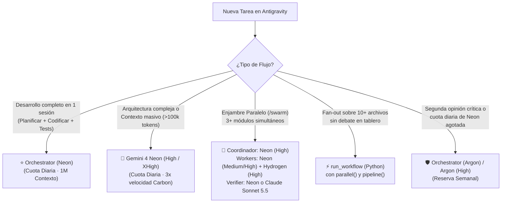

# Gemini 4 (Neon / Argon / Hydrogen) Orchestrator & Swarm Pro

Habilidad estratégica para maximizar el rendimiento de la familia **Gemini 4** —con **Gemini 4 Neon** y **`Orchestrator (Neon)`** como motor estrella de programación (1 millón de tokens de ventana unificada entrada/salida y cuota diaria)— junto con **`Argon`** y **`Hydrogen`**, desplegando equipos de agentes en paralelo mediante **`/swarm`** y **`run_workflow`** en el plan **Gemini AI Pro**.

---

## 1. Mapa Real de Modelos Gemini 4 en tu Plan Gemini Pro

Verificado en vivo con `swarm{action:"models", all:true}` en tu cuenta **Gemini Pro**:

| Modelo en Antigravity | ID Interno (`model`) | Ciclo de Cuota | Ventana / Perfil | Rol Ideal en Ingeniería |
| :--- | :--- | :--- | :--- | :--- |
| **Orchestrator (Neon)** ⭐ | `gemini-pro-orchestrator-neon` | **Diario (24h)** | **1M tokens unificados** | **Motor Principal Recomendado:** Planifica con Neon y delega ejecución rápida en Hydrogen con recarga diaria. |
| **Gemini 4 Neon** (`Low` / `Medium` / `High` / `XHigh`) ⭐ | `gemini-4-neon-*` | **Diario (24h)** | **1M tokens (In/Out)**, 3x más rápido que Carbon | **Programación Compleja y Agentes:** Líder de `/swarm`, diseño multi-archivo, refactorización masiva y análisis de repositorios enteros sin gastar cuota semanal. |
| **Gemini 4 Hydrogen** (`Low` / `Medium` / `High` / `XHigh`) | `gemini-4-hydrogen-*` | **Diario (24h)** | Alta velocidad y eficiencia | **Workers Ejecutores de `/swarm`:** Codificación paralela, ejecución de tests, UI y tareas de alta frecuencia. |
| **Orchestrator (Argon)** | `gemini-pro-orchestrator-g1-pro` | **Semanal (7d)** | Razonamiento profundo | **Reserva Estratégica Dual:** Úsalo cuando requieras una segunda opinión arquitectónica de Argon o si agotaste la cuota diaria de Neon. |
| **Gemini 4 Argon** (`Low` / `Medium` / `High`) | `gemini-4-argon-*` | **Semanal (7d)** | Razonamiento pesado | **Arquitecto de Reserva (Elephant):** Decisiones críticas puntuales. Protégelo de enjambres masivos por su reinicio semanal. |
| **Claude Opus 5.5 / Sonnet 5.5** | `claude-*-5-5-*` | **Diario (24h)** | Contraste multi-modelo | **Verificador Cruzado (*Goldfish* / `verifier`):** Ideal para auditar código generado por Neon/Hydrogen. |
| **Gemini 3.8 Flash** | `gemini-3.8-flash-*` | **Diario (24h)** | Ultraligero | **Subagentes Masivos:** `browser`, búsquedas rápidas y `run_workflow` de alto volumen. |
| *Gemini 4 Carbon* | *Exclusivo Ultra/Enterprise* | — | — | Cubierto en Gemini Pro por **Gemini 4 Neon (`High`/`XHigh`)** + **`Orchestrator (Neon)`**. |

---

## 2. Por Qué Gemini 4 Neon Cambia las Reglas en Gemini Pro

1. **Ventana Unificada de 1 Millón de Tokens (Entrada + Salida):** Permite cargar contextos masivos (repositorios completos, especificaciones EGM, subgrafos de `graphify` y trazas de logs) y generar salidas extensas de código sin truncamiento.
2. **Inteligencia Cercana a Carbon, 3x Más Rápido y con Cuota Diaria:** Mientras que `Argon` y `Orchestrator (Argon)` consumen una cuota que tarda **7 días** en reiniciarse, **`Gemini 4 Neon`** (`Low`, `Medium`, `High`, `XHigh`) y **`Orchestrator (Neon)`** se reinician **cada 24 horas**.
3. **Optimización de Coste por Tarea:** Diseñado específicamente para flujos agénticos (*tool use*, terminal, edición multi-archivo y coordinación de `/swarm`).

---

## 3. Árbol de Decisión: ¿Qué Modo y Modelo Elegir?



---

## 4. Protocolo `/swarm-pro` con Gemini 4 Neon + Hydrogen

### Paso 1: Verificar Cuotas y Nombrar el Enjambre
```json
swarm{"action": "models"}
swarm{"action": "title", "title": "Desarrollo Paralelo con Gemini 4 Neon"}
```

### Paso 2: Estrategia de Asignación de Modelos por Rol en `/swarm`
- **Coordinador Principal (tu sesión):** Selecciona **`Gemini 4 Neon (Medium o High)`** u **`Orchestrator (Neon)`** antes de iniciar el swarm. Así, todos los workers que hereden tu modelo usarán **cuota diaria** y ventana de **1M de tokens**.
- **Workers de Lógica Compleja / Backend / Arquitectura (`workspace: "share"`):**
  - Modelo: `gemini-4-neon-high` o `gemini-4-neon-medium` (o sin parámetro `model` si tu sesión ya está en Neon).
- **Workers de Ejecución Rápida / UI / Tests Unitarios (`workspace: "share"`):**
  - Modelo: `gemini-4-hydrogen-high` o `gemini-4-neon-medium`.
- **Verificadores Independientes (`workspace: "inherit"`):**
  - Añade **1 verificador por cada 2 a 4 autores** (`gemini-4-neon-high` o `claude-sonnet-5-5-high`). El verificador revisa diffs y corre tests, pero nunca edita los archivos del autor.

### Paso 3: Reglas de Aislamiento y Ciclo del Tablero
1. **Cero colisión de archivos:** Define en cada `brief` qué carpetas/archivos posee el worker y cuáles tiene prohibido tocar.
2. **Turno de creación:** Añade los workers con `swarm{action:"add"}`, muestra el enlace `open_board` al usuario y **finaliza tu turno** para que se habiliten `post_message`, `read_board` y `swarm_wait`.
3. **Coordinación eficiente:** Usa `swarm_wait{since: N}` y cita mensajes del tablero por número (`#3`, `#5`) sin duplicar texto.
4. **Failover en caliente sin perder memoria:** Si un modelo agota su cuota diaria, cámbialo con:
   ```json
   swarm{"action": "model", "name": "worker", "model": "gemini-4-hydrogen-high"}
   ```
   (o pasa a `gemini-4-argon-medium` como reserva semanal). Nunca uses `kill` para pausar.
5. **Integración antes de `kill`:** Fusiona los cambios de `workspace: "share"` o `"branch"` antes de eliminar cualquier worker autor.

---

## 5. Referencias Detalladas

- [references/model-tiers-and-quotas.md](references/model-tiers-and-quotas.md): Comparativa técnica de **Gemini 4 Neon vs. Argon vs. Hydrogen vs. Carbon** y matriz de cuotas verificadas.
- [references/swarm-playbooks.md](references/swarm-playbooks.md): Playbooks de `/swarm` y `run_workflow` potenciados con **Gemini 4 Neon**.
