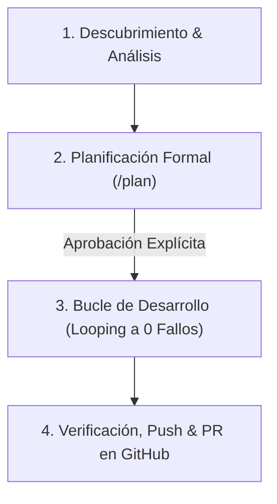

# Sprint Issue Developer Skill (Metodología Estandarizada de Desarrollo)

Esta habilidad guía al asistente Antigravity y a los agentes de ingeniería en la ejecución autónoma pero disciplinada de cualquier **Issue de Software** perteneciente a un **Sprint Técnico** (`S<Sprint>-<Nro>`), garantizando 100% de trazabilidad, criterios de aceptación validados, desarrollo en bucle sin errores y envío de Pull Requests sin palabras clave de auto-cierre indebido (`Ref #X`).

---

## Cuándo usar este skill (Triggers)

- Al recibir un Issue de desarrollo asignado a un Sprint técnico (ej. `S1-01`, `S2-03`).
- Cuando se deba ejecutar un flujo completo de implementación con pruebas automáticas y entrega vía GitHub MCP.
- Cuando el usuario solicite: *"Desarrolla el Issue X del Sprint Y"*, *"Implementa el requerimiento con la metodología de sprint"*, o *"Abre un PR para el Issue #N con trazabilidad"*.

---

## Inputs necesarios

- Identificador y título del Issue: `S<Sprint>-<Nro> - <Título>`.
- Carpeta de recursos del Sprint o especificaciones del requerimiento.
- Criterios de aceptación técnicos y funcionales.
- Repositorio Git limpio en rama `main`.

---

## 🧭 Flujo de Trabajo Operativo en 4 Fases (Plan → Validar → Ejecutar → Revisar)

### Fase 1: Descubrimiento y Análisis de Requerimientos
1. Identificar la ruta de trabajo (`Cwd`) y los recursos del Sprint.
2. Extraer del Issue: Objetivo principal, actividades, entregables y criterios de aceptación.
3. Verificar el estado de los Issues antecedentes en el Sprint (`Merged` vs `PR Abierto`).
4. Sincronizar rama base: `git checkout main` y `git pull origin main`.

### Fase 2: Planificación Formal (Planning Mode)
1. Generar el documento `implementation_plan.md` en artefactos con `request_feedback = true` y `user_facing = true`.
2. Incluir: objetivos, trazabilidad previa, cambios en código/documentación y plan de pruebas.
3. **Detener la ejecución y esperar la aprobación explícita del usuario** antes de escribir código o crear ramas.

### Fase 3: Bucle de Desarrollo y Autocorrección (Looping)
1. Crear rama de feature: `git checkout -b feature/s<X>-<Y>-<nombre_issue>`.
2. Desarrollar modularmente manteniendo consistencia 1:1 entre código, base de datos y diagramas.
3. **Bucle de Autocorrección (Looping)**:
   - Ante cualquier error de sintaxis, importación o falla en tests: leer logs completos, subsanar la causa raíz y re-ejecutar hasta lograr **0 fallos**.

### Fase 4: Verificación, Push y Pull Request
1. Ejecutar la suite completa de pruebas (`pytest`, `npm test`, etc.).
2. Commit acotado bajo Conventional Commits incluyendo siempre **`Ref #<Nro>`**.
   - **Regla estricta:** NUNCA usar palabras de auto-cierre (`Closes #X` / `Fixes #X`).
3. Push a GitHub: `git push -u origin feature/s<X>-<Y>-<nombre_issue>`.
4. Abrir Pull Request mediante GitHub MCP detallando entregables, criterios cumplidos y CI 🟢.

---

## 🎚️ Niveles de Libertad Operativa

- **Nivel de Libertad**: **Baja Libertad (Rigor Estricto / Pasos Exactos)**.
- Se debe respetar obligatoriamente el no auto-cierre (`Ref #X`), la aprobación previa del plan antes de modificar código y la verificación de 0 fallos antes de abrir el PR.

---

## 📋 Mini Checklist Operativo

- [ ] ¿Se extrajeron los criterios de aceptación completos del Issue?
- [ ] ¿El usuario aprobó formalmente el `implementation_plan.md`?
- [ ] ¿La suite de pruebas pasó con 0 errores?
- [ ] ¿Se utilizó `Ref #<Nro>` en vez de palabras clave de cierre automático?
- [ ] ¿El Pull Request fue creado y verificado con GitHub MCP?

---

## ⚠️ Manejo de Errores y Correcciones

- Si fallan las pruebas unitarias: pausar, analizar el trace de error, corregir el archivo fuente específico y re-ejecutar. No ignorar pruebas fallidas ni comentar asserts.
- Si hay discrepancia entre la rama actual y `main`, solicitar resolución de merge o rebase al usuario antes de proceder.
