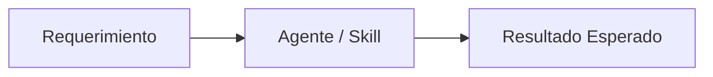

### 💡 Propuesta de Mejora / Funcionalidad
Describe detalladamente la nueva capacidad que deseas incorporar a Antigravity.

### 🎯 Caso de Uso y Justificación
¿Qué problema resuelve o qué ventaja estratégica aporta al flujo de desarrollo autónomo?

### 🛠️ Áreas de Impacto
- [ ] Nueva Habilidad Agéntica (`.agents/skills/`)
- [ ] Nuevo Rol en `agents_registry.json`
- [ ] Actualización de Reglas de Arquitectura / Stack
- [ ] Nueva herramienta o servidor MCP
- [ ] Optimización de Pipelines CI/CD

### 📐 Especificación Tentativa / Diagrama

### ✅ Criterios de Aceptación
- [ ] Documentado en `Docs/` y `README.md`
- [ ] Validado con `tests/` y `quick_validate.py`
- [ ] Conforme a los estándares de marca y Clean Architecture
