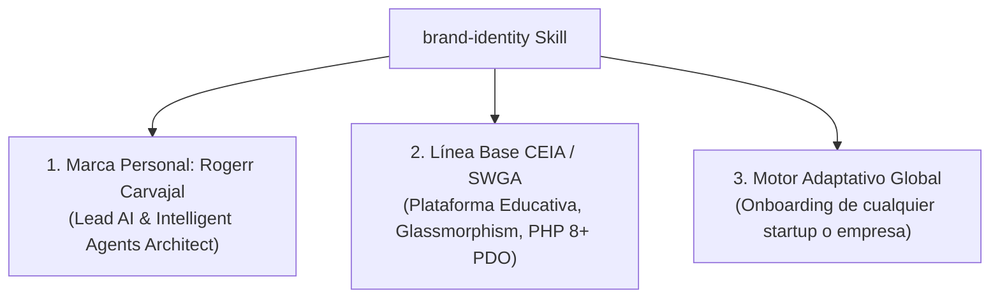

# 📊 Informe Técnico: Optimización Integral de Habilidades y Marca Personal del Desarrollador

> **Fecha:** 14 de Octubre de 2026  
> **Desarrollador Líder:** Rogerr Carvajal (`@rogerrcarvajal`)  
> **Especialidad:** Desarrollo de Soluciones con Modelos de Lenguaje y Agentes Inteligentes  
> **Repositorio Master:** `c:\xampp\htdocs\antigravity-rules`  
> **Configuración Global:** `C:\Users\Mary Carvajal\.gemini\config\skills`  

---

## 🎯 1. Optimización Basada en el Manual Oficial de Antigravity

A partir del documento de referencia del video (`creador-de-skills-antigravity.md`), se auditaron y optimizaron todas las habilidades para cumplir con los estándares rigurosos de ingeniería de Google Antigravity:

| Criterio de la Guía Oficial | Estado de Cumplimiento en el Ecosistema |
| :--- | :--- |
| **YAML frontmatter `name`** | Minúsculas, corto, con guiones, máx. 40 caracteres (`brand-identity`, `changelog-generator`, `skill-creator`, `sprint-issue-developer`). |
| **YAML frontmatter `description`** | En español, en 3.ª persona, estrictamente **≤ 220 caracteres**, enfocado en qué hace y cuándo usarlo (sin marketing). |
| **Estructura Mínima** | `SKILL.md` (obligatorio), `resources/` (guías y plantillas), `scripts/` (utilidades ejecutables) y `references/` (manuales). |
| **Flujo de Trabajo Estandarizado** | Todas las habilidades siguen el ciclo **Planificación → Validación → Ejecución → Revisión** con mini checklist operativa. |
| **Niveles de Libertad Definidos** | Explicitados en cada habilidad: **Alta** (heurísticas), **Media** (plantillas/documentos) o **Baja** (pasos estrictos / comandos frágiles). |
| **Manejo de Errores y Corrección** | Directrices explícitas sobre qué hacer ante resultados inesperados o ambigüedad antes de asumir supuestos. |

---

## 💎 2. Establecimiento de Marca Personal: Rogerr Carvajal

Se elevó el skill `brand-identity` de un enfoque dual a un **Modo Tri-Adaptativo**:

### Elementos Incorporados en `resources/developer-personal-brand.md`:
1. **Firma de Autoría Estandarizada:**
   - Bloques de cabecera formateados para código fuente (PHP, Python, TypeScript) y documentación técnica.
2. **Filosofía de Desarrollo Agent-First:**
   - Modelado para orquestación de agentes autónomos especializados.
   - Tipado estricto (Pydantic v2 en Python, strict types en PHP 8.2+).
   - Seguridad Zero-Trust (sin credenciales expuestas, validación estricta de esquemas, PDO obligatorio).
   - Trazabilidad total de Sprints (`Ref #X` sin auto-cierre indebido).
   - Estética visual superior (dark mode quantum, bordes translúcidos y glassmorphism con `backdrop-filter: blur(12px)`).
3. **Badges de Portafolio:**
   - Credenciales profesionales para `README.md` acreditando el desarrollo con Google Antigravity y arquitectura de agentes.

---

## 📁 3. Archivos Clave Integrados

- 📘 [creador-de-skills-antigravity.md](file:///c:/xampp/htdocs/antigravity-rules/Docs/creador-de-skills-antigravity.md): Guía oficial de diseño de skills incorporada en `Docs/` y en `skill-creator/references/`.
- 🏷️ [developer-personal-brand.md](file:///c:/xampp/htdocs/antigravity-rules/.agents/skills/brand-identity/resources/developer-personal-brand.md): Manual de marca personal de Rogerr Carvajal.
- 🎨 [brand-identity/SKILL.md](file:///c:/xampp/htdocs/antigravity-rules/.agents/skills/brand-identity/SKILL.md): Skill principal tri-adaptativo actualizado.
- 📝 [changelog-generator/SKILL.md](file:///c:/xampp/htdocs/antigravity-rules/.agents/skills/changelog-generator/SKILL.md): Optimizado con descripción ≤ 220 caracteres y flujo en 4 fases.
- 🛠️ [skill-creator/SKILL.md](file:///c:/xampp/htdocs/antigravity-rules/.agents/skills/skill-creator/SKILL.md): Actualizado con la metodología oficial y scripts de validación.
- 🔄 [sprint-issue-developer/SKILL.md](file:///c:/xampp/htdocs/antigravity-rules/.agents/skills/sprint-issue-developer/SKILL.md): Estandarizado con niveles de libertad estricta y mini checklist.
- 🌐 **Sincronización Dual y Global:** Reflejado idénticamente en `.agents/skills/`, `.gemini/skills/` y `~/.gemini/config/skills/`.
