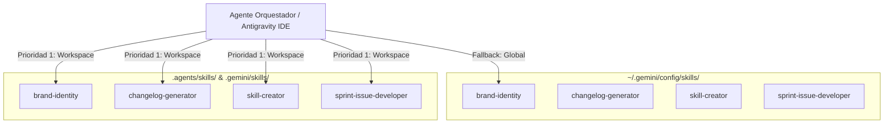

# 🧠 Guía del Ecosistema de Habilidades Autónomas (Agent Skills)

> **Documento Vivo del Proyecto:** `c:\xampp\htdocs\antigravity-rules\Docs\GUIA_HABILIDADES_AGENTICAS.md`  
> **Fecha:** Octubre 2026  
> **Ámbito:** Workspace (`.agents/skills/`) y Global (`~/.gemini/config/skills/`)

---

## 📌 1. Visión y Propósito

El ecosistema de **Habilidades Autónomas (Agent Skills)** en Google Antigravity extiende las capacidades de los agentes y subagentes mediante flujos de trabajo especializados cargados bajo demanda (*progressive disclosure*).

A diferencia de las reglas estáticas de código, las habilidades proporcionan **procedimientos paso a paso, generadores de artefactos, herramientas de validación y bancos de pruebas** que dotan a los agentes de capacidades complejas sin sobrecargar la ventana de contexto.

---

## 🏗️ 2. Arquitectura de Despliegue en 2 Niveles



---

## 🚀 3. Catálogo de Habilidades Autónomas

### 1. `brand-identity` (Marca Personal de Rogerr Carvajal, Diseño Glassmorphic & Stack Adaptativo)
- **Propósito**: Aplica y preserva la marca personal del desarrollador líder, sistemas de diseño visual y directrices arquitectónicas.
- **Modo Tri-Adaptativo**:
  - **1. Marca Personal del Desarrollador (Rogerr Carvajal)**: Establece la autoría, filosofía de ingeniería, tipado estricto, badges profesionales y bloques de firma de `@rogerrcarvajal` como especialista en **Modelos de IA y Agentes Inteligentes**.
  - **2. Línea Base Institucional / Académica (CEIA / SWGA)**: Implementación de referencia para plataformas educativas con modo oscuro futurista, glassmorphism (`backdrop-filter: blur(12px)`), PHP 8+ POO/MVC, PostgreSQL 14+ y PDO seguro.
  - **3. Modo Adaptativo Global**: Analiza y extrae automáticamente los colores, tipografía, stack y tono de voz de **cualquier nuevo proyecto empresarial, educativo o startup**.
- **Estructura Modular**:
  - `resources/developer-personal-brand.md`: Manual de marca personal de Rogerr Carvajal, principios y bloques de firma.
  - `resources/brand-analyzer.md`: Protocolo de onboarding y extracción de identidad.
  - `resources/design.md`: Paleta de colores, tipografía Inter/Outfit, componentes y reglas visuales.
  - `resources/tech-stack.md`: Estándares de backend, sanitización de inputs, índices DB y variables de entorno.
  - `resources/voice-tone.md`: Español técnico, fichas técnicas estilo Google AI Coding y convenciones Git.

### 2. `changelog-generator` (Generador de Notas de Lanzamiento)
- **Propósito**: Transforma historiales técnicos de Git en changelogs profesionales, categorizados y listos para clientes o usuarios finales.
- **Capacidades**:
  - Escaneo inteligente del historial Git por rango de fechas o entre versiones.
  - Clasificación en: ✨ *New Features*, ⚡ *Improvements*, 🐛 *Fixes*, 🔒 *Security*.
  - Traducción de jerga de commits a lenguaje de valor para el usuario.
  - Integración nativa con Conventional Commits y releases de GitHub.

### 3. `skill-creator` (Fábrica y Benchmark de Habilidades para Agentes)
- **Propósito**: Suite integral para diseñar, redactar, optimizar, evaluar y medir el rendimiento de nuevas habilidades de IA.
- **Estándar Oficial Incorporado**: Basado en [`Docs/creador-de-skills-antigravity.md`](./creador-de-skills-antigravity.md), adoptando:
  - YAML frontmatter riguroso (máximo 220 caracteres, tercera persona en español).
  - Flujo sistemático **Plan → Validar → Ejecutar → Revisar** con mini checklist.
  - 3 Niveles de libertad operativa (Alta, Media, Baja).
- **Componentes Incluidos**:
  - `references/creador-de-skills-antigravity.md`: Protocolo oficial paso a paso en español.
  - `scripts/quick_validate.py`: Validador sintáctico y de frontmatter YAML.
  - `scripts/improve_description.py`: Optimizador de trigger de activación para descripciones.
  - `scripts/run_eval.py` & `run_loop.py`: Ejecución de evaluaciones cuantitativas y bucles iterativos.
  - `eval-viewer/`: Visualizador web interactivo de evaluaciones (`viewer.html` y generador Python).
  - `agents/`: Prompts especializados (`analyzer.md`, `grader.md`, `comparator.md`).

### 4. `sprint-issue-developer` (Metodología de Desarrollo de Sprints en Bucle)
- **Propósito**: Conduce el desarrollo autónomo y riguroso de Issues de software en Sprints técnicos (`S<X>-<Y>`).
- **Flujo en 6 Fases**:
  1. *Descubrimiento y Parámetros*: Confirmación de rutas, recursos e issues antecedentes.
  2. *Análisis Estructurado*: Extracción de objetivos, actividades y criterios de aceptación.
  3. *Planificación Formal*: Generación de `implementation_plan.md` y espera de aprobación del usuario.
  4. *Bucle de Desarrollo (Looping)*: Creación de ramas feature, codificación modular y autocorrección guiada por logs hasta lograr **0 fallos**.
  5. *Matriz de Trazabilidad*: Uso estricto de `Ref #<Nro>` (prevención de auto-cierre indebido).
  6. *Publicación GitHub*: Pruebas automatizadas, push y apertura de Pull Request vía GitHub MCP.

---

## 🤖 4. Mapeo Agentes vs. Habilidades

En `.agents/agents/agents_registry.json`, los roles de ingeniería se asocian directamente con las habilidades:

| Agente | Rol Principal | Habilidades Clave Asignadas |
|---|---|---|
| `solution-architect` | Arquitectura C4, DDD, OpenAPI | `brand-identity`, `skill-creator` |
| `python-ai-engineer` | FastAPI, Pydantic v2, Pipelines IA | `sprint-issue-developer`, `skill-creator` |
| `backend-core-dev` | PHP 8.2+, XAMPP, PDO, PSR | `sprint-issue-developer`, `brand-identity` |
| `ui-ux-designer` | Tailwind, Accesibilidad WCAG, Glassmorphism | `brand-identity` |
| `qa-security-auditor` | Pentesting OWASP, Tests, GitHub Releases | `sprint-issue-developer`, `changelog-generator` |

---

## 📋 5. Comandos Rápidos de Validación

Para validar la integridad de cualquier habilidad:
```powershell
python .agents/skills/skill-creator/scripts/quick_validate.py .agents/skills/brand-identity
python .agents/skills/skill-creator/scripts/quick_validate.py .agents/skills/changelog-generator
python .agents/skills/skill-creator/scripts/quick_validate.py .agents/skills/skill-creator
python .agents/skills/skill-creator/scripts/quick_validate.py .agents/skills/sprint-issue-developer
```
