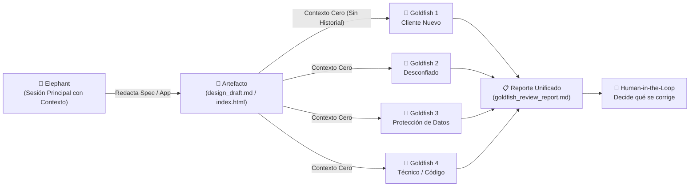

# Integración de Google Elephant-Goldfish Model (EGM) en Antigravity

## 1. Resumen Ejecutivo

**Elephant-Goldfish Model (EGM)** (`google/elephant-goldfish-model`) es un marco de ingeniería de software asistida por IA diseñado para eliminar el **sesgo de confirmación** y detectar **supuestos ocultos** antes de escribir código o entregar una aplicación a producción o clientes.



---

## 2. Arquitectura de Roles

| Rol | Memoria / Contexto | Responsabilidad |
| :--- | :--- | :--- |
| **Elephant (Elefante)** | Contexto completo del proyecto, historial de chat, arquitectura y decisiones previas. | Comprender el problema, explorar ideas (`/egm-brainstorm`) y redactar especificaciones (`/egm-draft`) o código. |
| **Goldfish (Peces Dorados)** | **Contexto cero** (`invoke_subagent` aislado). No conoce la conversación previa. | Auditar solo el archivo escrito frente al contexto real del negocio y estándares técnicos, exponiendo fallos invisibles para el Elefante. |
| **Humano** | Criterio de negocio y prioridades. | Evaluar los hallazgos (🔴 Bloqueantes, 🟡 Importantes, 🟢 Detalles) y decidir qué se corrige antes de avanzar. |

---

## 3. Componentes Integrados en Antigravity

### A. Plugin Oficial Global (`~/.gemini/config/plugins/egm/`)
Contiene las 7 habilidades oficiales de EGM y los 10 agentes revisores de diseño:
- `/egm-brainstorm`: Poner a prueba una idea y generar `concepts_brief.md`.
- `/egm-draft`: Transformar el brief en `design_draft.md` sección por sección.
- `/egm-review`: Revisar especificaciones en 5 pasadas con subagentes Goldfish.
- `/egm-review-loop`: Revisión configurable con revisores y estándares personalizados.
- `/egm-resolve`: Repasar hallazgos con el usuario y acordar cambios.
- `/egm-bootstrap`: Documentar una base de código existente.
- `/egm-drift-report`: Comparar documentos con el código fuente actual.

### B. Skill `egm-auditoria` (Kit EGM en Español)
Ubicada en `.agents/skills/egm-auditoria/`, `.gemini/skills/egm-auditoria/` y `~/.gemini/config/skills/egm-auditoria/`:
- **`peces/cliente.md`**: Cliente nuevo desde móvil con prisa, sin conocer el negocio.
- **`peces/desconfiado.md`**: Usuario escéptico buscando letra pequeña, precios ocultos o contradicciones.
- **`peces/proteccion-datos.md`**: Auditor de privacidad, RGPD, formularios, cookies y exposición de datos.
- **`peces/tecnico.md`**: Revisor técnico que verifica si lo que promete la pantalla ocurre realmente en el código.
- **`peces/estandar-web-negocio.md`**: Vara de medir común para los 4 revisores.
- **`plantilla-contexto/`**: `notas-del-negocio.md` y `resenas.md` para contrastar el producto contra la operación real.

### C. Regla y Workflow
- **Regla:** `.agents/rules/elephant-goldfish-model.md` (y global `70-elephant-goldfish-model.md`).
- **Workflow:** `/egm-auditar` (`.agents/workflows/egm-auditar.md`).

---

## 4. Cómo Ejecutar una Auditoría

1. Copia `peces/` y `plantilla-contexto/` (renombrada como `contexto/`) en tu proyecto y rellena `notas-del-negocio.md` y `resenas.md`.
2. Lanza la auditoría en el chat de Antigravity:
   ```text
   /egm-auditar
   TargetFile: index.html
   Reviewers: peces/cliente.md, peces/desconfiado.md, peces/proteccion-datos.md, peces/tecnico.md
   Standards: peces/estandar-web-negocio.md
   GoldfishContext: contexto/notas-del-negocio.md, contexto/resenas.md
   ```
3. Antigravity lanzará 4 subagentes `research` aislados en paralelo, consolidará `goldfish_review_report.md` y te pedirá confirmación antes de aplicar cualquier corrección.
