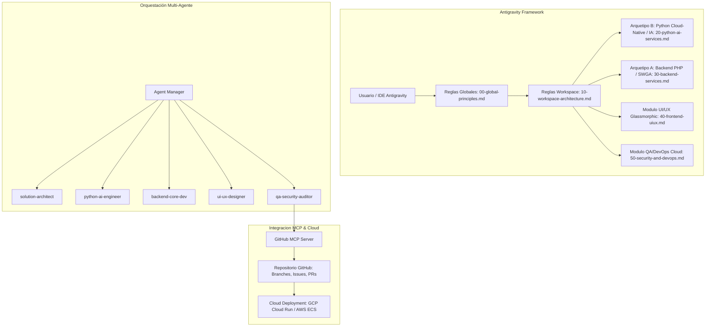

# Plan de Implementación: Configuración Profunda de Antigravity (IDE, Reglas, GitHub MCP & Multi-Agentes)

> **Documento Vivo del Proyecto:** `c:\xampp\htdocs\antigravity-rules\Docs\PLAN_IMPLEMENTACION_ANTIGRAVITY.md`  
> **Fecha de Actualización:** 31 de Octubre de 2026  
> **Estado:** Implementado, Expandido y Verificado (Multi-Arquetipo & Cloud-Native)

---

## 1. Visión y Alcance del Proyecto
El objetivo es transformar Google Antigravity en una suite de desarrollo autónomo y cooperativo de nivel empresarial, con:
1. **Sistema de Personalización en 3 Niveles:** Instrucciones jerárquicas Globales, de Workspace y por Carpeta/Módulo.
2. **Diseño y Roles de Trabajo:** Flujo de desarrollo estructurado (Planificación -> Arquitectura -> Desarrollo -> QA -> GitHub MCP).
3. **Integración MCP Server:** Conexión nativa con **GitHub MCP** para control de versiones, creación de ramas y Pull Requests autónomos.
4. **Sistema Multi-Agente Políglota de Alto Impacto:** Especialización de roles con soporte para **Python (IA / Agentes / FastAPI / Cloud-Native)**, **PHP 8.2+ (XAMPP / APIs Core / Transaccional)**, **TypeScript / Tailwind** y arquitecturas modernas (**Clean Architecture, DDD, Event-Driven**).
5. **Arquitectura Multi-Arquetipo Adaptativa:**
   - **Arquetipo A (Core Web Transaccional - CEIA / SWGA):** PHP 8.2+ POO/MVC, PostgreSQL 14+, PDO seguro, HTML5/CSS3. Totalmente protegido y preservado sin afectación.
   - **Arquetipo B (Cloud-Native & Intelligent Agent Ecosystem - Wellness 2.0 / Vanguardia):** Python 3.11+, FastAPI asíncrono, Pydantic v2, PostgreSQL + pgvector (RAG Híbrido), orquestación de agentes inteligentes, UI Glassmorphic/Tailwind y despliegue a la nube (GCP Cloud Run, AWS App Runner/ECS) desde GitHub.

---

## 2. Jerarquía de Reglas en 3 Niveles

### Nivel 1: Global (Entorno y Principios Transversales)
- Archivo: `.gemini/rules/00-global-principles.md` (y copia en `Docs/00-global-principles.md`).
- Define:
  - Idioma español técnico, conciso y con formateo Markdown riguroso.
  - Principios SOLID, Clean Architecture, DRY y tipado fuerte universal.
  - Política de seguridad Zero-Trust: Prohibido hardcodear credenciales en código.
  - Estándar de confirmaciones *Conventional Commits*.

### Nivel 2: Workspace (Arquitectura Políglota, Multi-Arquetipo y de Alto Impacto)
- Archivo: `.gemini/rules/10-workspace-architecture.md` (y copia en `Docs/10-workspace-architecture.md`).
- Define:
  - **Arquetipo A (Transaccional - CEIA / SWGA):** PHP 8.2+, Apache/XAMPP, PostgreSQL 14+, PDO prepared statements, HTML5/CSS3. Cero impacto para sistemas existentes.
  - **Arquetipo B (Cloud-Native & IA - Wellness Platform 2.0):** Python 3.11+, FastAPI asíncrono, Pydantic v2, PostgreSQL con pgvector + BM25, Redis, agentes autónomos, Docker multi-stage y despliegue continuo desde GitHub a GCP / AWS.
  - Arquitectura Hexagonal (Ports & Adapters) y Domain-Driven Design (DDD).
  - Flujo obligatorio de desarrollo guiado por planes (`/plan`).

### Nivel 3: Carpeta / Módulo (Reglas Especializadas)
- **Python, Agentes & IA Cloud-Native:** `.gemini/rules/20-python-ai-services.md` (Pydantic v2, `async def`, StateGraph, Tool Calling tipado, RAG híbrido, variable `$PORT`, healthcheck `/health`, Docker multi-stage no-root).
- **Backend PHP:** `.gemini/rules/30-backend-services.md` (PSR-4/7/12, PDO Prepared Statements, respuestas API uniformes, PHP2Shell check).
- **Frontend UI/UX:** `.gemini/rules/40-frontend-uiux.md` (Tokens Tailwind, glassmorphism, accesibilidad WCAG 2.1 AA, estados de UI).
- **Seguridad, DevOps & Cloud:** `.gemini/rules/50-security-and-devops.md` (OWASP Top 10, pruebas unitarias, GitHub Actions CI/CD hacia GCP/AWS, GitHub MCP con `Ref #X`).

---

## 3. Configuración de GitHub MCP Server
Antigravity integra el servidor MCP oficial de GitHub (`@modelcontextprotocol/server-github`), configurado con el Personal Access Token (PAT).

- **Herramientas Activadas:**
  - `search_repositories` & `get_file_contents`: Análisis de repositorios remotos.
  - `create_branch` & `push_files`: Publicación de cambios en ramas feature.
  - `create_pull_request` & `merge_pull_request`: Automatización del ciclo de entrega continua.
  - `create_issue` & `list_issues`: Trazabilidad de tareas y bugs.

---

## 4. Ecosistema Multi-Agente
Se registraron 5 roles en `.agents/agents/agents_registry.json` (y `.gemini/agents/agents_registry.json`):
1. **`solution-architect`**: Diseña diagramas C4/Mermaid, contratos OpenAPI, selección de arquetipos y modelos DDD.
2. **`python-ai-engineer`**: Desarrolla microservicios con FastAPI, pipelines de IA, agentes inteligentes y validación Pydantic v2.
3. **`backend-core-dev`**: Implementa lógica transaccional PHP bajo XAMPP con PDO y PSR-12 para sistemas Arquetipo A.
4. **`ui-ux-designer`**: Construye componentes frontend accesibles, responsivos y con design tokens de Tailwind y Glassmorphism.
5. **`qa-security-auditor`**: Audita código contra OWASP Top 10, ejecuta tests y abre Pull Requests vía GitHub MCP hacia pipelines CI/CD de GCP/AWS.

---

## 5. Ecosistema de Habilidades Autónomas (Agent Skills)
Se integraron y ajustaron habilidades autónomas tanto a nivel local (`.agents/skills/`) como a nivel global (`~/.gemini/config/skills/`):
1. **`brand-identity`**: Estándar adaptativo multi-arquetipo de identidad de marca (Rogerr Carvajal), diseño glassmorphic y soporte dual para Arquetipo A (CEIA/SWGA) y Arquetipo B (Cloud-Native AI-First Wellness 2.0).
2. **`changelog-generator`**: Generador automatizado de notas de release profesionales a partir del historial de commits de Git.
3. **`skill-creator`**: Framework integral con scripts de evaluación, validación y banco de pruebas para crear y refinar nuevas habilidades.
4. **`sprint-issue-developer`**: Flujo metódico para resolver Issues técnicos en bucle guiado por pruebas hasta 0 fallos, con trazabilidad `Ref #X`.
