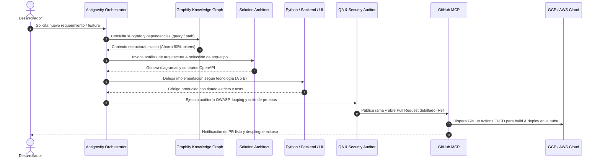

# 🚀 Antigravity Deep Configuration: Ecosistema de Desarrollo Autónomo de Alto Rendimiento

> **Transformando Google Antigravity en una Suite de Ingeniería de Software Inteligente, Multi-Arquetipo, Políglota, Cloud-Native y Optimizada con Grafos de Conocimiento (GraphRAG).**

[](https://antigravity.google)
[](https://modelcontextprotocol.io)
[](https://github.com/Graphify-Labs/graphify)
[](https://github.com)
[](https://github.com)
[](https://github.com)
[](https://github.com/rogerrcarvajal/antigravity-deep-configuration/actions)

---

## 📌 1. Objetivo del Proyecto

El objetivo primordial de este proyecto es llevar la configuración de **Google Antigravity** más allá de un simple asistente de completado de código, convirtiéndolo en un **ecosistema de desarrollo autónomo de alto rendimiento**. 

A través de esta configuración profunda, el IDE y el Gestor de Agentes se convierten en un equipo de ingeniería completo capaz de:
1. **Planificar y Diseñar** arquitecturas complejas antes de codificar (`/plan` y diagramas Mermaid).
2. **Navegar la Arquitectura con Grafos de Conocimiento (`graphify`)** reduciendo hasta un **80% el consumo de tokens** mediante consultas semánticas y caminos de dependencias en lugar de barridos masivos de archivos.
3. **Operar bajo Reglas Jerárquicas en 3 Niveles** (Global, Workspace y Carpeta) garantizando código limpio, seguro y tipado.
4. **Gobernar una Arquitectura Multi-Arquetipo Adaptativa**:
   - **Arquetipo A (Core Web & Transaccional - CEIA / SWGA):** PHP 8.2+ POO/MVC, PostgreSQL 14+, PDO seguro y HTML5/CSS3. Totalmente protegido y preservado sin afectación a sistemas existentes.
   - **Arquetipo B (Cloud-Native & Intelligent Agent Ecosystem - Wellness Platform 2.0 / Vanguardia):** Python 3.11+, FastAPI asíncrono, Pydantic v2, PostgreSQL + pgvector (RAG Híbrido), orquestación de agentes inteligentes, UI Glassmorphic/Tailwind y despliegue a la nube (**GCP Cloud Run, AWS App Runner / ECS**) desde GitHub.
5. **Interactuar directamente con GitHub y Servidores MCP** para automatizar ramas, commits, issues, Pull Requests y consultas al grafo de conocimiento.
6. **Orquestar Multi-Agentes Especializados** con roles, responsabilidades y herramientas bien acotadas.

---

## 🏗️ 2. Arquitectura del Ecosistema

El sistema se estructura en cuatro pilares fundamentales: **Gobierno por Reglas Contextuales**, **Orquestación Multi-Agente & GraphRAG**, **Ecosistema de Habilidades Autónomas (Skills)** y **Puente de Integración MCP & Cloud Deployment**.

```mermaid
graph TD
    subgraph 1. Jerarquía de Reglas Contextuales & Knowledge Graph
        A[Google Antigravity IDE] --> B[Nivel Global: ~/.gemini/config]
        B --> C[Nivel Workspace: .agents/rules]
        C --> D1["⚡ Arquetipo B: Python Cloud-Native & IA<br/>(20-python-ai-services.md)"]
        C --> D2["🏛️ Arquetipo A: Core Web PHP & SWGA<br/>(30-backend-services.md)"]
        C --> D3["🎨 Módulo Frontend UI/UX Glassmorphic<br/>(40-frontend-uiux.md)"]
        C --> D4["🛡️ Módulo QA, DevOps & Multi-Cloud<br/>(50-security-and-devops.md)"]
        C --> D5["🕸️ Regla Graphify: Ahorro de Tokens<br/>(rules/graphify.md)"]
    end

    subgraph 2. Orquestación Multi-Agente & GraphRAG
        E[Agent Manager Orchestrator] --> F1["🎯 solution-architect<br/>(DDD, C4, Contratos OpenAPI)"]
        E --> F2["🐍 python-ai-engineer<br/>(FastAPI, Pydantic, Agents, pgvector)"]
        E --> F3["🐘 backend-core-dev<br/>(PHP 8.2, XAMPP, PDO, PSR-12)"]
        E --> F4["🎨 ui-ux-designer<br/>(Tailwind, Glassmorphism, WCAG 2.1 AA)"]
        E --> F5["🛡️ qa-security-auditor<br/>(OWASP Top 10, TDD, Looping)"]
    end

    subgraph 3. Habilidades Autónomas (Skills)
        S1["🎨 brand-identity<br/>(Multi-Arquetipo, Glassmorphic, Brand)"]
        S2["📝 changelog-generator<br/>(Git Commits -> User Changelog)"]
        S3["⚡ skill-creator<br/>(Evals, Benchmarks, Templates)"]
        S4["🔄 sprint-issue-developer<br/>(Looping, Trazabilidad, Ref #X)"]
        S5["🕸️ graphify<br/>(Knowledge Graph, AST, 80% Token Savings)"]
    end

    subgraph 4. Conexión MCP & Despliegue Multi-Cloud
        F5 --> G1[GitHub MCP Server]
        E --> G2[Graphify MCP Server]
        G1 --> H["📦 Repositorio GitHub<br/>(Ramas, Commits, PRs, Issues)"]
        H --> I["☁️ Despliegue Multi-Cloud CI/CD<br/>(GCP Cloud Run / AWS ECS / PaaS)"]
    end

    F1 -.-> S1 & S3 & S5
    F2 -.-> S3 & S4 & S5
    F3 -.-> S1 & S4 & S5
    F4 -.-> S1
    F5 -.-> S2 & S4
```

---

## 🕸️ 3. Optimización de Tokens con Graphify Knowledge Graph

Para evitar lecturas innecesarias de archivos completos y acelerar el razonamiento en arquitecturas de gran escala, el entorno incorpora la integración nativa con **Graphify**:

```
Código Fuente / Workspace ──► AST Tree-sitter (Local, $0 Tokens) ──► graphify-out/graph.json
                                                                           │
               Consultas Semánticas: graphify query / path / explain ◄─────┘
                         (Ahorro de hasta un 80% de tokens)
```

- **Indexación sin costo de tokens:** Utiliza parsers locales Tree-sitter para mapear clases, métodos, llamadas y dependencias.
- **Consultas focalizadas:** En lugar de enviar 50 archivos al contexto del agente, Antigravity ejecuta `graphify query "<pregunta>"` o `graphify path "<MóduloA>" "<MóduloB>"` para extraer únicamente el subgrafo relevante.
- **Visualizador 3D/2D:** Genera `graphify-out/graph.html` para inspección interactiva en el navegador y `graphify-out/GRAPH_REPORT.md` con detección de comunidades y god nodes.

---

## 🧭 4. Matriz de Arquetipos de Desarrollo

Antigravity detecta dinámicamente el perfil del proyecto sin acoplamiento forzado:

| Dimensión | Arquetipo A: Core Web Transaccional (CEIA / SWGA) | Arquetipo B: Cloud-Native & AI-First (Wellness 2.0) |
|---|---|---|
| **Caso de Uso** | Sistemas de gestión académica, ERPs, APIs transaccionales. | Asistentes inteligentes, sistemas RAG, agentes autónomos, analítica de IA. |
| **Backend & Core** | PHP 8.2+ POO / MVC / PSR-4, 7, 12, 15. | Python 3.11+ / 3.12+, FastAPI asíncrono (`async def`), Pydantic v2. |
| **Enfoque de IA** | Integración externa vía APIs REST / MCP. | Agentes autónomos nativos, StateGraphs, Tool Use tipado, RAG Híbrido. |
| **Base de Datos** | PostgreSQL 14+ / MariaDB con PDO Prepared Statements. | PostgreSQL + `pgvector` (búsqueda densa) + BM25 (léxica) + Redis (estados). |
| **Frontend & UI** | HTML5 semántico, CSS3 Vanilla, JavaScript nativo. | HTML5 semántico, CSS3 Glassmorphic / Tailwind tokens, JavaScript reactivo. |
| **Despliegue** | Apache / Nginx (XAMPP local), VPS, Servidor Dedicado. | **Docker multi-stage**, serverless container desplegable desde GitHub a **GCP Cloud Run**, **AWS ECS / App Runner** o PaaS. |

---

## 🎯 5. Sistema de Reglas en 3 Niveles

Antigravity evalúa el contexto en cascada para aplicar las restricciones exactas según el archivo editado:

| Nivel | Ubicación | Responsabilidad y Alcance |
| :--- | :--- | :--- |
| **Nivel 1: Global** | `.gemini/rules/00-global-principles.md` | Estándares transversales: Español técnico, SOLID, Clean Architecture, seguridad **Zero-Trust** (cero secretos en código) y Conventional Commits. |
| **Nivel 2: Workspace** | `.gemini/rules/10-workspace-architecture.md` | Arquitectura Hexagonal (Ports & Adapters), Domain-Driven Design (DDD), gobernanza multi-arquetipo y flujo obligatorio `/plan`. |
| **Nivel 3: Carpeta / Módulo** | `.gemini/rules/20-*.md` a `50-*.md`<br>`rules/graphify.md` | Reglas hiper-especializadas: tipado asíncrono con Pydantic v2 en Python, Prepared Statements en PHP, Tailwind en UI, auditorías OWASP en QA y consultas de grafo en `graphify.md`. |

---

## 🤖 6. Ecosistema Multi-Agente (Agent Management)

En el modo de Administración de Agentes, las responsabilidades se distribuyen entre especialistas:



---

## 🔌 7. Integración MCP (GitHub & Graphify)

Gracias a **Model Context Protocol (MCP)**, los agentes tienen acceso directo y seguro tanto a GitHub como al grafo de conocimiento:

```json
{
  "mcpServers": {
    "github": {
      "command": "npx",
      "args": ["-y", "@modelcontextprotocol/server-github"],
      "env": {
        "GITHUB_PERSONAL_ACCESS_TOKEN": "TU_TOKEN_PERSONAL"
      }
    },
    "graphify": {
      "command": "uv",
      "args": [
        "run",
        "--with",
        "graphifyy",
        "--with",
        "mcp",
        "-m",
        "graphify.serve",
        "${workspace.path}/graphify-out/graph.json"
      ]
    }
  }
}
```

---

## ⚡ 8. Ecosistema de Habilidades Autónomas (Agent Skills)

| Habilidad (Skill) | Ámbito y Propósito | Archivos Clave |
| :--- | :--- | :--- |
| **`graphify`** | **Knowledge Graph & Token Saver:** Convierte cualquier carpeta de código en un grafo de conocimiento navegable; consultas BFS/DFS (`query`), caminos de dependencias (`path`), explicaciones (`explain`) y sincronización incremental (`update .`). | `SKILL.md`, `references/query.md`, `references/update.md`, `references/exports.md`, `references/extraction-spec.md` |
| **`brand-identity`** | **Multi-Arquetipo**: Marca personal de **Rogerr Carvajal** (especialista en Modelos de IA & Agentes Autónomos), soporte dual para Arquetipo A (CEIA/SWGA: PHP 8+, PostgreSQL) y Arquetipo B (Cloud-Native AI-First: Python FastAPI, pgvector, Docker, GCP/AWS). | `SKILL.md`, `resources/developer-personal-brand.md`, `resources/design.md`, `resources/tech-stack.md` |
| **`changelog-generator`** | Transforma historiales de commits técnicos de Git en notas de versión profesionales categorizadas (features, mejoras, correcciones) para usuarios finales y releases de GitHub. | `SKILL.md` |
| **`skill-creator`** | Suite integral basada en la guía oficial `creador-de-skills-antigravity.md` para crear, optimizar, evaluar y ejecutar benchmarks de nuevas habilidades con validación sintáctica y visualizador web. | `SKILL.md`, `references/`, `scripts/`, `eval-viewer/` |
| **`sprint-issue-developer`** | Metodología estructurada en 4 fases para resolver Issues de Sprints técnicos con bucle de autocorrección (looping) guiado por logs hasta 0 fallos, trazabilidad `Ref #X` y PRs limpios. | `SKILL.md`, `prompts/sprint_issue_development_guide.md` |

---

## 📁 9. Estructura del Repositorio

```text
antigravity-deep-configuration/
├── .agents/                              # Raíz Oficial de Personalización Antigravity
│   ├── rules/
│   │   ├── 00-global-principles.md       # Reglas Globales (Nivel 1)
│   │   ├── 10-workspace-architecture.md  # Arquitectura Multi-Arquetipo y DDD (Nivel 2)
│   │   ├── 20-python-ai-services.md      # Microservicios Python, Agentes & IA (Nivel 3)
│   │   ├── 30-backend-services.md        # Backend PHP 8.2+ y XAMPP (Nivel 3)
│   │   ├── 40-frontend-uiux.md           # Diseño UI/UX y Tailwind (Nivel 3)
│   │   ├── 50-security-and-devops.md     # Seguridad OWASP, DevOps y Cloud (Nivel 3)
│   │   └── graphify.md                   # Regla Always-On: Consulta Semántica y Ahorro Tokens
│   ├── workflows/
│   │   └── graphify.md                   # Workflow Oficial de Ejecución Graphify
│   ├── agents/
│   │   └── agents_registry.json          # Registro de Roles Multi-Agente con Skills asociadas
│   ├── skills/                           # Habilidades Autónomas del Workspace
│   │   ├── graphify/                     # Grafo de Conocimiento y Navegación AST
│   │   ├── brand-identity/               # Marca Personal Rogerr Carvajal & Multi-Arquetipo
│   │   ├── changelog-generator/          # Generador de Notas de Lanzamiento desde Git
│   │   ├── skill-creator/                # Suite Oficial de Creación y Evaluación de Habilidades
│   │   └── sprint-issue-developer/       # Metodología de Desarrollo de Sprints en Bucle
│   └── mcp_config.json                   # Servidores MCP (GitHub & Graphify)
├── .gemini/                              # Compatibilidad y Espejo Dual
├── .github/                              # Plantillas y Automatización GitHub Actions
├── Docs/
│   ├── INTEGRACION_GRAPHIFY_KNOWLEDGE_GRAPH.md # Guía Completa de Graphify & Ahorro de Tokens
│   ├── PLAN_IMPLEMENTACION_ANTIGRAVITY.md      # Plan maestro y alcance técnico
│   ├── WALKTHROUGH_EJECUCION.md               # Guía práctica paso a paso
│   ├── SELECCION_SKILLS_Y_AGENT_LOOP.md       # Matriz de skills de élite y diseño del Agent Loop
│   ├── GUIA_HABILIDADES_AGENTICAS.md          # Guía detallada del ecosistema de habilidades
│   └── creador-de-skills-antigravity.md       # Manual Oficial de Creación de Skills
├── tests/                                # Suite Automatizada de Pruebas Unitarias e Integración
└── README.md                             # Documentación principal de la comunidad
```

---

## 🚀 10. Guía de Inicio Rápido

1. **Clonar el proyecto:**
   ```bash
   git clone https://github.com/rogerrcarvajal/antigravity-deep-configuration.git
   cd antigravity-deep-configuration
   ```
2. **Generar el Grafo de Conocimiento (Ahorro de Tokens):**
   ```bash
   # Indexa el repositorio actual con Graphify
   /graphify .
   ```
3. **Configurar GitHub MCP & Graphify MCP:**
   - Define tu Personal Access Token (PAT) en la configuración de Antigravity MCP.
4. **Iniciar en Antigravity IDE:**
   - Abre la carpeta del proyecto en Google Antigravity. Las reglas de `.gemini/rules/` y `.agents/rules/` se cargarán automáticamente.
5. **Desarrollar con Agentes Autónomos:**
   - Usa el comando `/plan` para que el agente `solution-architect` estructure cualquier requerimiento consultando previamente el grafo de conocimiento.

---

## 📜 11. Licencia y Créditos
Desarrollado para la comunidad de desarrolladores de **Google Antigravity**, basado en las mejores prácticas de ingeniería de software, arquitectura hexagonal, orquestación agéntica, grafos de conocimiento GraphRAG y despliegue cloud-native.
