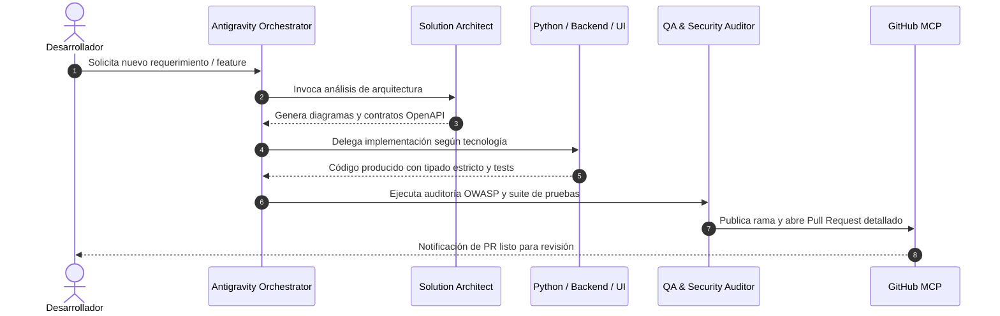

# 🚀 Antigravity Deep Configuration: Ecosistema de Desarrollo Autónomo de Alto Rendimiento

> **Transformando Google Antigravity en una Suite de Ingeniería de Software Inteligente, Políglota y Multi-Agente.**

[](https://antigravity.google)
[](https://modelcontextprotocol.io)
[](https://github.com)
[](https://github.com)

---

## 📌 1. Objetivo del Proyecto

El objetivo primordial de este proyecto es llevar la configuración de **Google Antigravity** más allá de un simple asistente de completado de código, convirtiéndolo en un **ecosistema de desarrollo autónomo de alto rendimiento**. 

A través de esta configuración profunda, el IDE y el Gestor de Agentes se convierten en un equipo de ingeniería completo capaz de:
1. **Planificar y Diseñar** arquitecturas complejas antes de codificar (`/plan` y diagramas Mermaid).
2. **Operar bajo Reglas Jerárquicas en 3 Niveles** (Global, Workspace y Carpeta) garantizando código limpio, seguro y tipado.
3. **Desarrollar en un Stack Políglota de Alto Impacto** (Python para IA/Data, PHP 8.2+ para APIs transaccionales bajo XAMPP, TypeScript para Frontend reactivo).
4. **Interactuar directamente con GitHub vía MCP (Model Context Protocol)** para automatizar ramas, commits, issues y Pull Requests sin salir del flujo de trabajo.
5. **Orquestar Multi-Agentes Especializados** con roles, responsabilidades y herramientas bien acotadas.

---

## 🏗️ 2. Arquitectura del Ecosistema

El sistema se estructura en cuatro pilares fundamentales: **Gobierno por Reglas Contextuales**, **Orquestación Multi-Agente**, **Ecosistema de Habilidades Autónomas (Skills)** y **Puente de Integración MCP**.

```mermaid
graph TD
    subgraph 1. Jerarquía de Reglas Contextuales
        A[Google Antigravity IDE] --> B[Nivel Global: ~/.gemini/config]
        B --> C[Nivel Workspace: .agents/rules]
        C --> D1[Módulo Python & IA: 20-python-ai-services.md]
        C --> D2[Módulo Backend Core: 30-backend-services.md]
        C --> D3[Módulo Frontend UI/UX: 40-frontend-uiux.md]
        C --> D4[Módulo QA & DevOps: 50-security-and-devops.md]
    end

    subgraph 2. Orquestación Multi-Agente
        E[Agent Manager Orchestrator] --> F1["🎯 solution-architect<br/>(DDD, C4, Contratos OpenAPI)"]
        E --> F2["🐍 python-ai-engineer<br/>(FastAPI, Pydantic, Embeddings)"]
        E --> F3["🐘 backend-core-dev<br/>(PHP 8.2, XAMPP, PDO, PSR-12)"]
        E --> F4["🎨 ui-ux-designer<br/>(Tailwind, WCAG 2.1 AA)"]
        E --> F5["🛡️ qa-security-auditor<br/>(OWASP Top 10, TDD)"]
    end

    subgraph 3. Habilidades Autónomas (Skills)
        S1["🎨 brand-identity<br/>(Tokens, Design System, Adaptive)"]
        S2["📝 changelog-generator<br/>(Git Commits -> User Changelog)"]
        S3["⚡ skill-creator<br/>(Evals, Benchmarks, Templates)"]
        S4["🔄 sprint-issue-developer<br/>(Looping, Trazabilidad, PRs)"]
    end

    subgraph 4. Conexión Externa via Model Context Protocol
        F5 --> G[GitHub MCP Server]
        G --> H["📦 Repositorio GitHub<br/>(Ramas, Commits, PRs, Issues)"]
    end

    F1 -.-> S1 & S3
    F2 -.-> S3 & S4
    F3 -.-> S1 & S4
    F4 -.-> S1
    F5 -.-> S2 & S4
```

---

## 🎯 3. Sistema de Reglas en 3 Niveles

Antigravity evalúa el contexto en cascada para aplicar las restricciones exactas según el archivo editado:

| Nivel | Ubicación | Responsabilidad y Alcance |
| :--- | :--- | :--- |
| **Nivel 1: Global** | `.gemini/rules/00-global-principles.md` | Estándares transversales: Español técnico, SOLID, Clean Architecture, seguridad **Zero-Trust** (cero secretos en código) y Conventional Commits. |
| **Nivel 2: Workspace** | `.gemini/rules/10-workspace-architecture.md` | Arquitectura Hexagonal (Ports & Adapters), Domain-Driven Design (DDD), stack políglota y flujo obligatorio guiado por `/plan`. |
| **Nivel 3: Carpeta / Módulo** | `.gemini/rules/20-*.md` a `50-*.md` | Reglas hiper-especializadas: tipado asíncrono con Pydantic v2 en Python, Prepared Statements en PHP, tokens de Tailwind en UI y auditorías OWASP en QA. |

---

## 🤖 4. Ecosistema Multi-Agente (Agent Management)

En el modo de Administración de Agentes, las responsabilidades se distribuyen entre especialistas:



### Roles Definidos en `.gemini/agents/agents_registry.json`:
1. **`solution-architect`**: Modela entidades de dominio, casos de uso y diagramas de flujo antes de escribir código.
2. **`python-ai-engineer`**: Implementa servicios FastAPI no bloqueantes (`async def`), validaciones Pydantic y conectores de IA/LLMs.
3. **`backend-core-dev`**: Gestiona lógica de negocio transaccional bajo XAMPP, consultas preparadas PDO y respuestas JSON normalizadas.
4. **`ui-ux-designer`**: Construye componentes accesibles con estados interactivos completos (`idle`, `loading`, `error`, `empty`).
5. **`qa-security-auditor`**: Garantiza cobertura de pruebas, previene inyecciones/vulnerabilidades y entrega mediante GitHub MCP.

---

## 🔌 5. Integración GitHub MCP Server

Gracias a **Model Context Protocol (MCP)**, los agentes tienen acceso directo y seguro a la API de GitHub:

```json
{
  "mcpServers": {
    "github": {
      "command": "npx",
      "args": ["-y", "@modelcontextprotocol/server-github"],
      "env": {
        "GITHUB_PERSONAL_ACCESS_TOKEN": "TU_TOKEN_PERSONAL"
      }
    }
  }
}
```

### Capacidades MCP Habilitadas:
- 🔍 `search_repositories` & `get_file_contents`: Inspección contextual de repositorios remotos.
- 🌿 `create_branch` & `push_files`: Creación de ramas y commits atómicos directos.
- 🔀 `create_pull_request` & `merge_pull_request`: Automatización del ciclo de entrega continua.
- 📋 `create_issue` & `list_issues`: Trazabilidad completa de bugs y requerimientos.

---

## ⚡ 6. Ecosistema de Habilidades Autónomas (Agent Skills)

Además de reglas y agentes, el framework incorpora **habilidades autónomas** cargadas bajo demanda (*on-demand progressive disclosure*), disponibles tanto a nivel local (`.agents/skills/`) como a nivel global del sistema (`~/.gemini/config/skills/`):

| Habilidad (Skill) | Ámbito y Propósito | Archivos Clave |
| :--- | :--- | :--- |
| **`brand-identity`** | **Tri-Adaptativo**: Marca personal de **Rogerr Carvajal** (especialista en Modelos de IA & Agentes Autónomos), línea base CEIA/SWGA (dark mode + glassmorphism), estándares de stack (PHP 8+, PostgreSQL 14+, Python 3.11+) y adaptación a cualquier proyecto. | `SKILL.md`, `resources/developer-personal-brand.md`, `resources/brand-analyzer.md`, `resources/design.md`, `resources/tech-stack.md`, `resources/voice-tone.md` |
| **`changelog-generator`** | Transforma historiales de commits técnicos de Git en notas de versión profesionales categorizadas (features, mejoras, correcciones) para usuarios finales y releases de GitHub. | `SKILL.md` |
| **`skill-creator`** | Suite integral basada en la guía oficial `creador-de-skills-antigravity.md` para crear, optimizar, evaluar y ejecutar benchmarks de nuevas habilidades con validación sintáctica y visualizador web. | `SKILL.md`, `references/creador-de-skills-antigravity.md`, `scripts/`, `eval-viewer/`, `agents/` |
| **`sprint-issue-developer`** | Metodología estructurada en 4 fases para resolver Issues de Sprints técnicos con bucle de autocorrección (looping) guiado por logs hasta 0 fallos, trazabilidad `Ref #X` y PRs limpios. | `SKILL.md`, `prompts/sprint_issue_development_guide.md` |

---

## 📁 7. Estructura del Repositorio

```text
antigravity-deep-configuration/
├── .agents/                              # Raíz Oficial de Personalización Antigravity
│   ├── rules/
│   │   ├── 00-global-principles.md       # Reglas Globales (Nivel 1)
│   │   ├── 10-workspace-architecture.md  # Arquitectura Políglota y DDD (Nivel 2)
│   │   ├── 20-python-ai-services.md      # Microservicios Python & IA (Nivel 3)
│   │   ├── 30-backend-services.md        # Backend PHP 8.2+ y XAMPP (Nivel 3)
│   │   ├── 40-frontend-uiux.md           # Diseño UI/UX y Tailwind (Nivel 3)
│   │   └── 50-security-and-devops.md     # Seguridad OWASP y DevOps (Nivel 3)
│   ├── agents/
│   │   └── agents_registry.json          # Registro de Roles Multi-Agente con Skills asociadas
│   ├── skills/                           # Habilidades Autónomas del Workspace
│   │   ├── brand-identity/               # Marca Personal Rogerr Carvajal & Diseño Tri-Adaptativo
│   │   ├── changelog-generator/          # Generador de Notas de Lanzamiento desde Git
│   │   ├── skill-creator/                # Suite Oficial de Creación y Evaluación de Habilidades
│   │   └── sprint-issue-developer/       # Metodología de Desarrollo de Sprints en Bucle
│   └── mcp_config.json                   # Plantilla de Configuración MCP
├── .gemini/                              # Compatibilidad y Espejo Dual
│   ├── rules/                            # Espejo de reglas
│   ├── agents/                           # Espejo de agentes
│   ├── skills/                           # Espejo de habilidades
│   └── mcp_config.json                   # Espejo de MCP
├── Docs/
│   ├── PLAN_IMPLEMENTACION_ANTIGRAVITY.md# Plan maestro y alcance técnico
│   ├── WALKTHROUGH_EJECUCION.md         # Guía práctica paso a paso
│   ├── GUIA_HABILIDADES_AGENTICAS.md    # Guía detallada del ecosistema de habilidades
│   ├── creador-de-skills-antigravity.md # Manual Oficial de Creación de Skills para Antigravity
│   └── [respaldos de todas las reglas]  # Copia de seguridad local
└── README.md                             # Documentación principal de la comunidad
```

---

## 🚀 8. Guía de Inicio Rápido

1. **Clonar el proyecto:**
   ```bash
   git clone https://github.com/rogerrcarvajal/antigravity-deep-configuration.git
   cd antigravity-deep-configuration
   ```
2. **Configurar GitHub MCP:**
   - Define tu Personal Access Token (PAT) en la configuración de Antigravity MCP o en tu archivo `.env`.
3. **Iniciar en Antigravity IDE:**
   - Abre la carpeta del proyecto en Google Antigravity. Las reglas de `.gemini/rules/` se cargarán automáticamente en cada sesión de chat y en cada edición de archivo.
4. **Desarrollar con Agentes Autónomos:**
   - Usa el comando `/plan` para que el agente `solution-architect` estructure cualquier requerimiento antes de implementarlo.

---

## 📜 8. Licencia y Créditos
Desarrollado para la comunidad de desarrolladores de **Google Antigravity**, basado en las mejores prácticas de ingeniería de software, arquitectura hexagonal y orquestación agentica moderna.
