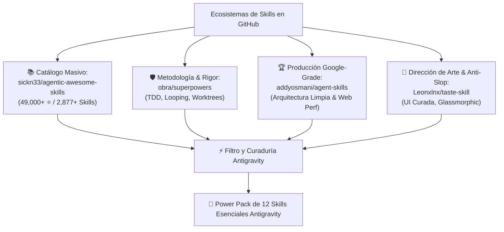
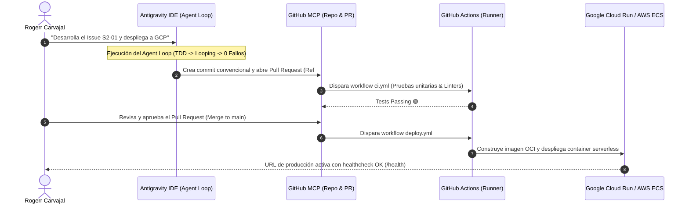

# 🚀 Guía Maestra: Matriz de Selección de Skills y Adaptación del Agent Execution Loop en Google Antigravity

> **Documento Vivo del Proyecto:** `c:\xampp\htdocs\antigravity-rules\Docs\SELECCION_SKILLS_Y_AGENT_LOOP.md`  
> **Autor:** Rogerr Carvajal (`@rogerrcarvajal`)  
> **Especialidad:** Lead AI Engineer & Autonomous Agent Systems Architect  
> **Fecha de Publicación:** 31 de Octubre de 2026  
> **Repositorio Oficial:** [`rogerrcarvajal/antigravity-deep-configuration`](https://github.com/rogerrcarvajal/antigravity-deep-configuration)

---

## 📌 1. Resumen Ejecutivo y Visión Estratégica

En la nueva era de la programación asistida por Inteligencia Artificial, el uso pasivo de LLMs como meros autocompletadores de código ha quedado obsoleto. Las organizaciones de alto rendimiento y los investigadores en **Sistemas Inteligentes** requieren entornos capaces de operar como **equipos autónomos de ingeniería de software**.

Esta guía formaliza:
1. **La Evaluación y Curaduría de Repositorios de Skills en GitHub**, contrastando catálogos masivos como `sickn33/agentic-awesome-skills` frente a marcos metodológicos de alta disciplina (`obra/superpowers`, `addyosmani/agent-skills`, `Leonxlnx/taste-skill`).
2. **La Adaptación del Autonomous Agent Execution Loop (Agent Loop)** analizado en la literatura de ingeniería agentica (`Gy4ECDG_hI4`) hacia el entorno de **Google Antigravity**.
3. **El Power Pack Curado de 12 Skills Esenciales** para maximizar la productividad, garantizar código tipado, robusto y seguro, y potenciar la marca personal del desarrollador.
4. **La Arquitectura Multi-Arquetipo y Despliegue Multi-Cloud** (Google Cloud Platform, AWS, Azure, PaaS) orquestado directamente desde GitHub mediante **GitHub MCP**.

---

## 📊 2. Auditoría Comparativa de Repositorios de Skills en GitHub



### Análisis Técnico por Repositorio:

| Repositorio | Enfoque Principal | Aporte de Valor | Riesgo Potencial | Estrategia de Mitigación |
| :--- | :--- | :--- | :--- | :--- |
| **`sickn33/agentic-awesome-skills`** *(49k+ ⭐)* | Directorio masivo universal de `SKILL.md` estructurados. | Paquetes especializados (*AAS Agent & MCP Builder*, *AAS Security Engineer*, *AAS DevOps & Cloud*). | **Agent Overload:** Cargar cientos de skills satura el contexto y diluye la atención del LLM. | **Instalación Selectiva:** Incorporar solo playbooks de alto impacto mediante progressive disclosure. |
| **`obra/superpowers`** | Metodología disciplinada de desarrollo guiado por agentes. | TDD obligatorio, bucles de corrección, planificación sin modificaciones prematuras y revisión de código. | Enfocado netamente en la entrega de software, sin plantillas de branding ni diseño visual. | **Combinar con `brand-identity`** y arquetipos de diseño personalizados. |
| **`addyosmani/agent-skills`** | Patrones de ingeniería de producción creados por Addy Osmani (Google). | Arquitectura limpia, resiliencia, contratos API y rendimiento web de nivel empresarial. | Catálogo reducido en comparación con directorios abiertos. | Utilizar como estándar dorado para interfaces y APIs críticas. |
| **`Leonxlnx/taste-skill`** | Dirección de arte e inmunidad contra el "AI-Slop". | Evita que el agente genere páginas genéricas, usando modo oscuro cuántico, tipografía curada y referencias reales. | Limitado exclusivamente al frontend. | Fusionar sus principios dentro de la skill `brand-identity` y componentes glassmórficos. |

---

## 🔄 3. El Autonomous Agent Execution Loop (Adaptado a Antigravity)

Inspirado en la ingeniería de control de agentes autónomos y en el análisis del video *"What Actually Happens When an AI Agent Writes Your Code?"* (`Gy4ECDG_hI4`), el **Agent Loop de Antigravity** opera como una máquina de estados determinista con retroalimentación en bucle cerrado:

```mermaid
stateDiagram-v2
    [*] --> PlanAndDeconstruct: Requerimiento / Issue (Ref #X)
    
    state PlanAndDeconstruct {
        [*] --> AnalizarRequisitos
        AnalizarRequisitos --> DetectarArquetipo: Arquetipo A (PHP) vs Arquetipo B (Cloud/AI)
        DetectarArquetipo --> GenerarDiagramasC4: Modelado Mermaid
        GenerarDiagramasC4 --> EsperarAprobacionUsuario: /plan en implementation_plan.md
    }

    PlanAndDeconstruct --> WorkspaceIsolation: Aprobación Explícita
    
    state WorkspaceIsolation {
        [*] --> CrearBranchGit: feature/sX-Y-slug
        CrearBranchGit --> PrepararSandbox: Entorno aislado
    }

    WorkspaceIsolation --> ToolExecution: Acción
    
    state ToolExecution {
        [*] --> EscribirTestsTDD: tests unitarios previos
        EscribirTestsTDD --> EscribirCodigoTipado: Pydantic v2 / PDO strict
        EscribirCodigoTipado --> EjecutarHerramientasTerminal: run_command (pytest / linter)
    }

    ToolExecution --> BackpressureObservation: Observación
    
    state BackpressureObservation {
        [*] --> CapturarStdoutStderr
        CapturarStdoutStderr --> EvaluarResultados
    }

    BackpressureObservation --> SelfCorrectionLoop: ¿Existen errores o fallos?
    
    state SelfCorrectionLoop {
        [*] --> LeerStackTraceRaiz
        LeerStackTraceRaiz --> AislarFalla: Sin suposiciones aleatorias
        AislarFalla --> ModificarArchivoEspecifico
    }
    
    SelfCorrectionLoop --> ToolExecution: Re-ejecutar bucle (Looping a 0 fallos)

    BackpressureObservation --> GatingAndVerification: 100% Tests en Verde (0 Fallos)

    state GatingAndVerification {
        [*] --> EvidenciaEmpirica: Comprobar asserts reales
        EvidenciaEmpirica --> SanitizarConfiguracion: Cero secretos expuestos
    }

    GatingAndVerification --> DeliveryGitHubMCP: Entrega y Despliegue
    
    state DeliveryGitHubMCP {
        [*] --> ConventionalCommit: Ref #X (sin auto-cierre indebido)
        ConventionalCommit --> PushGitHubMCP: push_files / git push
        PushGitHubMCP --> CrearPullRequestMCP: PR detallado con checklist
        CrearPullRequestMCP --> DispararCICDCloud: GitHub Actions -> GCP Cloud Run / AWS ECS
    }

    DeliveryGitHubMCP --> [*]: Éxito y Notificación
```



### Reglas Inviolables del Agent Loop en Antigravity:
1. **Backpressure Real (Sin Alucinaciones):** El agente nunca presume que el código funciona. La validación proviene exclusivamente de la terminal (`pytest`, `npm test`, linters) capturando códigos de salida reales (`exit code 0`).
2. **Looping Autónomo de Autocorrección:** Ante fallos de sintaxis o tests rotos, el agente **no se detiene a pedir ayuda inmediata**. Entra en modo de autocorrección: lee el trace de error, identifica la causa raíz, aplica la corrección puntual y vuelve a evaluar hasta alcanzar **cero errores**.
3. **Barrera de Salida Estricta (Gatekeeper):** Se prohíbe terminantemente realizar commits o abrir Pull Requests si existe al menos una prueba fallida o secretos expuestos.
4. **Trazabilidad Disciplinada:** Cada entrega debe enlazar formalmente al issue (`Ref #<ID>`) sin palabras clave de cierre automático (`Closes #X`), permitiendo revisión humana antes del merge.

---

## 💎 4. El Power Pack Curado: 12 Skills Esenciales

A partir de la auditoría de repositorios y las necesidades de proyectos de maestría e industria, se seleccionaron **12 habilidades clave** distribuidas en 5 pilares estratégicos:

```text
.agents/skills/ (y ~/.gemini/config/skills/)
├── 1. Metodología & Agent Loop
│   ├── sprint-issue-developer     # Flujo autónomo de sprint con bucle a 0 fallos y Ref #X
│   ├── test-driven-development    # TDD estricto: test unitario antes del código
│   └── systematic-debugging       # Diagnóstico científico por causa raíz y aislamiento
├── 2. Arquitectura & Contratos
│   ├── c4-model                   # Diagramación Mermaid en 4 niveles (Contexto a Código)
│   ├── api-spec-generation        # Contratos OpenAPI 3.1 y JSON Schemas desacoplados
│   └── clean-code                 # Arquitectura Hexagonal (Ports & Adapters) y SOLID
├── 3. Inteligencia Artificial & Agentes
│   ├── agent-mcp-builder          # Orquestación de agentes con StateGraph y herramientas MCP
│   └── hybrid-rag-optimizer       # RAG híbrido: pgvector (denso) + BM25 (léxico) + RRF
├── 4. Diseño & Marca Personal
│   ├── brand-identity             # Marca personal Rogerr Carvajal y gobernanza Multi-Arquetipo
│   └── taste-ui-glassmorphism     # Art direction, glassmorphism cuántico y anti-AI-slop
└── 5. DevOps, Cloud & Releases
    ├── cloud-native-docker        # Dockerfile multi-stage no-root y despliegue a GCP/AWS
    └── changelog-generator        # Generador de notas de release profesionales desde Git
```

---

## 🛠️ 5. Matriz Operativa de Invocación de Skills

| Necesidad de Desarrollo | Habilidad a Activar | Comando / Disparador Sugerido en Antigravity |
| :--- | :--- | :--- |
| **Planificar un requerimiento complejo** | `c4-model` + `api-spec-generation` | `/plan Diseña la arquitectura en 4 niveles y los contratos OpenAPI para el nuevo microservicio de agentes.` |
| **Desarrollar una funcionalidad de sprint** | `sprint-issue-developer` + `test-driven-development` | `Desarrolla el Issue S2-03 aplicando TDD estricto en bucle a 0 fallos y entrega con Ref #45.` |
| **Construir un agente autónomo o servicio RAG** | `agent-mcp-builder` + `hybrid-rag-optimizer` | `Construye el agente de nutrición con StateGraph, memoria en pgvector y búsqueda híbrida BM25.` |
| **Diseñar interfaz web de alto impacto** | `brand-identity` + `taste-ui-glassmorphism` | `Aplica la identidad de Rogerr Carvajal y diseña el dashboard con glassmorphism cuántico en modo oscuro.` |
| **Empaquetar y desplegar a la nube** | `cloud-native-docker` | `Genera el Dockerfile multi-stage optimizado para GCP Cloud Run y el workflow de GitHub Actions.` |
| **Auditar un error difícil o bug crítico** | `systematic-debugging` | `Ejecuta systematic-debugging para aislar la causa raíz del fallo en la memoria vectorial.` |
| **Cerrar sprint y publicar release** | `changelog-generator` | `Genera el changelog categorizado de los commits del Sprint 2 y redacta la nota de versión.` |

---

## ☁️ 6. Flujo de Despliegue Multi-Cloud desde GitHub Actions

Para los proyectos basados en el **Arquetipo B (Cloud-Native & AI-First)**, la integración del Agent Loop se conecta automáticamente con la nube:



---

## 📚 7. Referencias y Bibliografía Técnica

1. **Agentic Awesome Skills Catalog:** [`https://github.com/sickn33/agentic-awesome-skills`](https://github.com/sickn33/agentic-awesome-skills) (AAS Core, Plugins & Playbooks).
2. **Superpowers Methodology:** [`https://github.com/obra/superpowers`](https://github.com/obra/superpowers) (Agentic Skills Framework & Disciplined Development).
3. **Production-Grade Engineering Skills:** [`https://github.com/addyosmani/agent-skills`](https://github.com/addyosmani/agent-skills) (Addy Osmani, Google).
4. **Taste Skill & Art Direction:** [`https://github.com/Leonxlnx/taste-skill`](https://github.com/Leonxlnx/taste-skill) (Anti-AI Slop & Visual Excellence).
5. **Video Tutoriales de Antigravity (Migue Baena):**
   - *Antigravity Skills: the new system mode that makes you work 10x faster* (`3KLFKnunr7I`).
   - *The complete workflow to create and publish your app* (`irq-elQEHuY` / `RDuVmE95IWQ`).
6. **Agent Execution Loop Architecture:**
   - *What Actually Happens When an AI Agent Writes Your Code?* (`Gy4ECDG_hI4`).
